<p align="center"></p>

<p align="center">
  
  
  
  
</p>

## En une phrase

TerraMind aide les petits maraîchers des Niayes (Sénégal) à **choisir quoi planter selon leur sol et la saison**, à **anticiper les maladies grâce à la météo** et à **reconnaître une maladie sur la photo d'une plante** (feuille, fruit ou plante entière). Chaque conseil cite le document d'où il vient.

## L'application en images

<p align="center">
  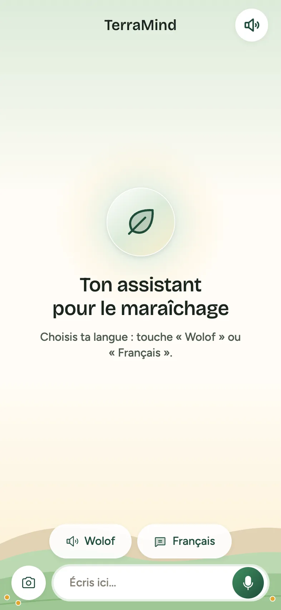 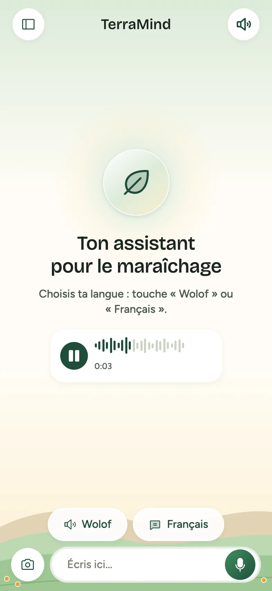 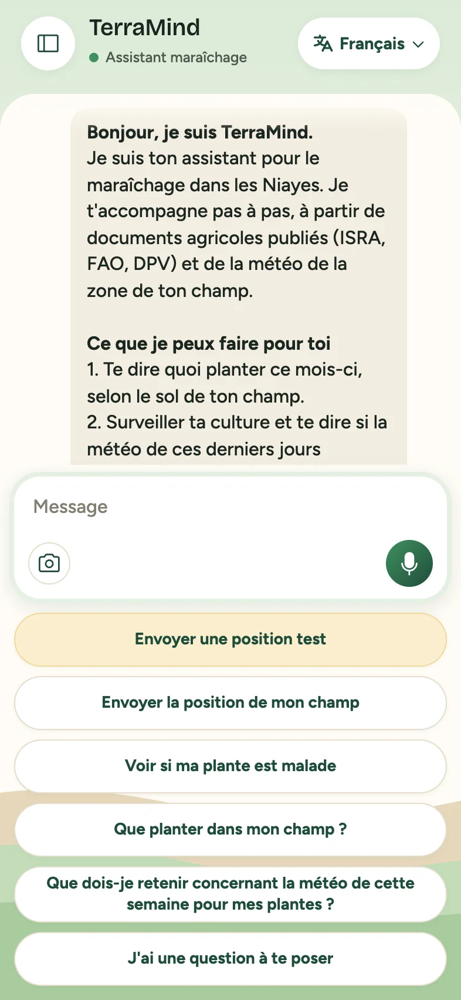  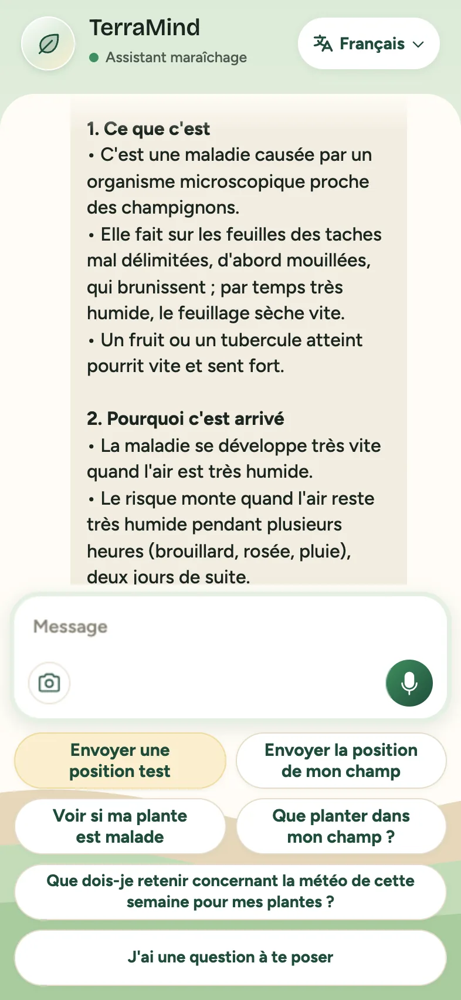 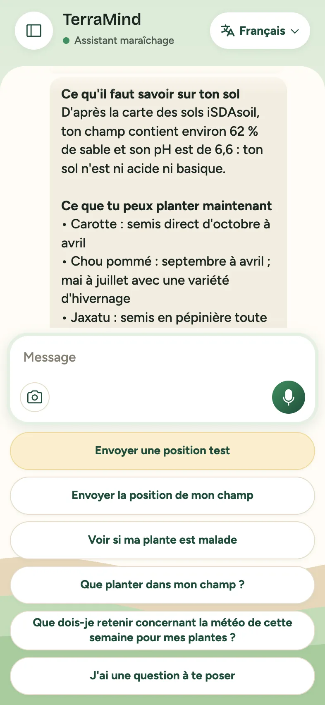 
</p>

<sub>Vraies captures de l'application branchée sur le moteur (écran d'iPhone 16, 393 × 852 points), 15 nov 2026. Bienvenue → langue → accueil → diagnostic → explication → plan → alertes. Photo du diagnostic : jeu de test de TOM2024 (CC BY 4.0), jamais vue à l'entraînement. Le visage des écrans de bienvenue et d'accueil est une image générée par IA.</sub>

## Le bot Telegram en images

<p align="center">
  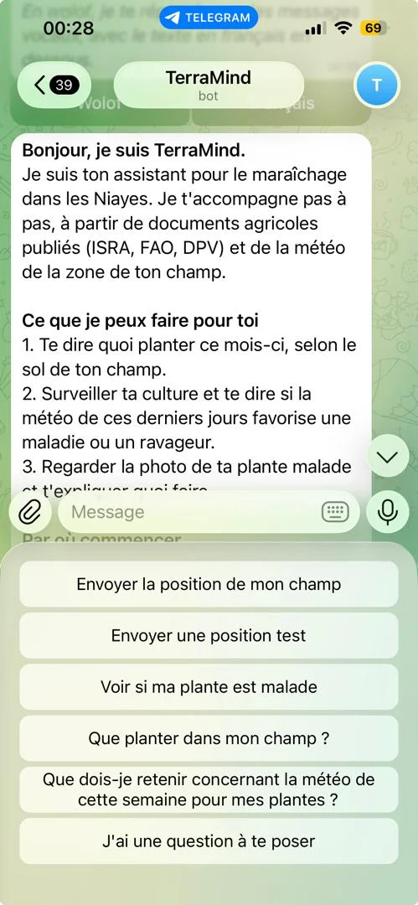 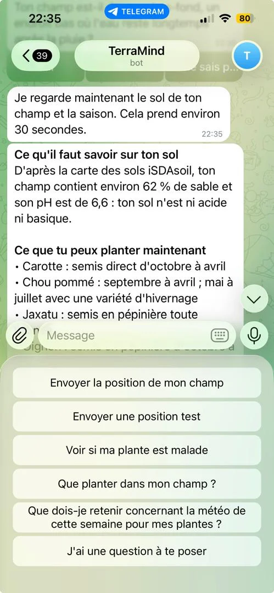 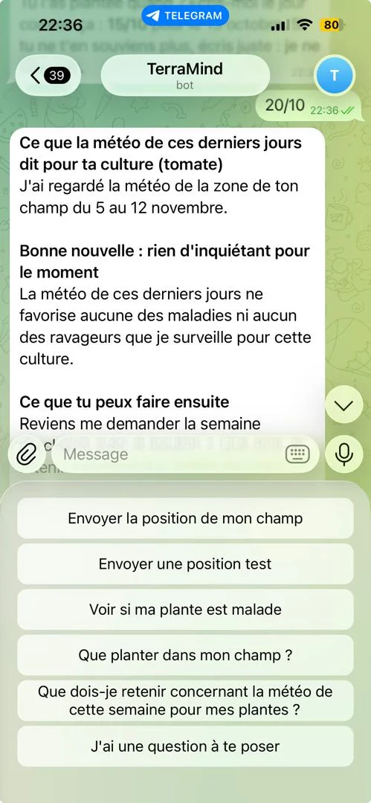 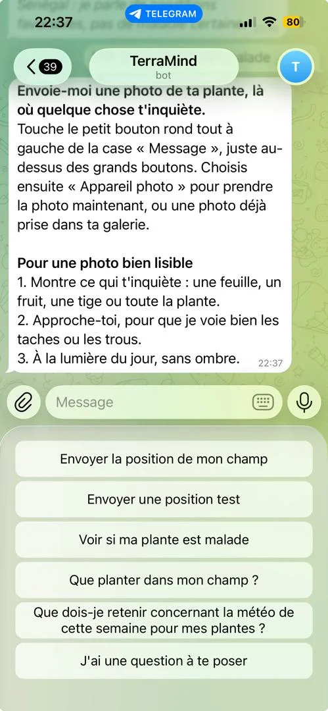  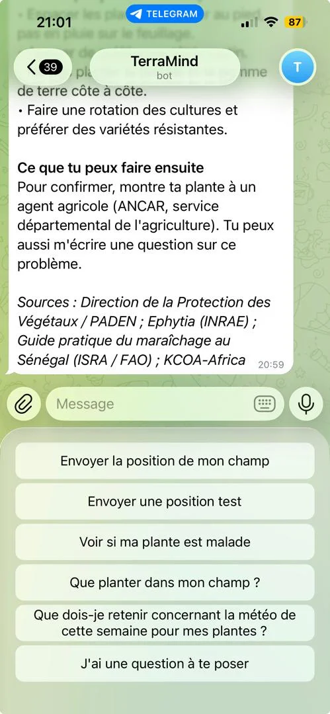 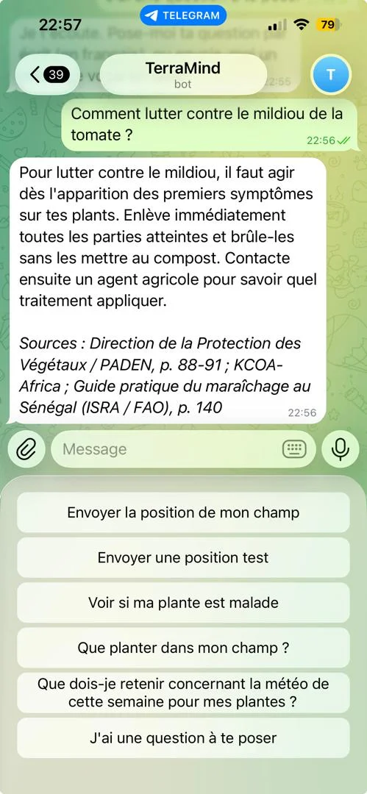
</p>

<sub>Vraies captures du bot @TerraMindAfriqueBot sur un iPhone, branché sur le moteur en ligne (Render), 15 et 16 nov 2026. Position : bouton « Envoyer une position test » (Rufisque, zone pilote des Niayes), pas la position d'un agriculteur. Photo du diagnostic : jeu de test de TOM2024 (CC BY 4.0), jamais vue à l'entraînement. Le mode wolof (notes vocales) sera ajouté après la relecture des traductions.</sub>

## Ce que l'agriculteur peut faire

| | Il fait… | TerraMind répond… | À partir de… |
|---|---|---|---|
| 🌱 | partage la position de son champ | les cultures conseillées ce mois-ci, avec les avertissements (sel, acidité) | carte des sols iSDAsoil + guide ISRA 1987 |
| 🔔 | déclare sa culture et sa date de repiquage | les risques de la semaine : mildiou, alternariose, mineuse, teigne | météo NASA POWER au point du champ |
| 📷 | photographie une feuille | la maladie probable expliquée en 4 temps (ce que c'est, pourquoi, que faire, comment éviter), ou « je ne suis pas sûr » | modèle de diagnostic + fiches sourcées |
| 💬 | pose une question | une réponse tirée uniquement des fiches, ou « je ne sais pas » | 23 fiches vérifiées + Gemini |

## Comment ça marche : un moteur, deux façades

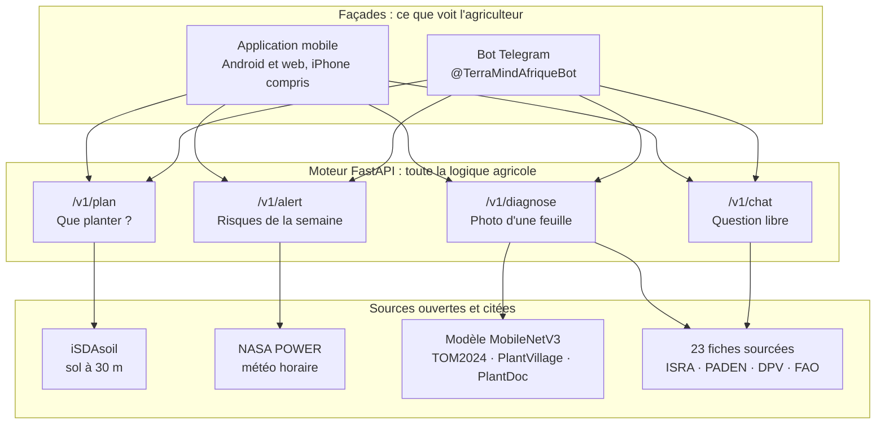

L'application et le bot n'ont **aucune logique agricole** : ils appellent le même moteur ([décision D1](docs/decisions.md)). C'est ce qui a permis de passer de WhatsApp à Telegram, sans toucher à la logique agricole, quand Meta a bloqué notre compte ([D12](docs/decisions.md), [récit complet](docs/difficultes.md)).

> **Analogie Kuroko no Basket** : le moteur est Kuroko. Il ne marque pas lui-même les paniers, ce sont les façades qui parlent à l'agriculteur. Mais c'est lui qui fait circuler chaque ballon vers le bon coéquipier (sol, météo, photo, fiches). Concrètement, une seule base de code agricole sert toutes les façades.

## Où en est le projet (13 nov 2026)

| Brique | État | Chiffres clés |
|---|---|---|
| Que planter | ✅ réel | 6 cultures, règles du guide ISRA 1987, sol lu au point du champ |
| Alertes météo | ✅ réel | 4 risques ; règles testées sur la météo 2020-2025 |
| Diagnostic photo | ✅ modèle v1 | **91,7 %** sur 1 058 photos de terrain africaines (TOM2024) ; **56,9 %** sur 102 photos PlantDoc ; « je ne suis pas sûr » sous le seuil |
| Questions libres | ✅ réel | 23 fiches ; 3 passes de vérification indépendante (environ 320 affirmations, 51 corrigées) |
| Application mobile | ✅ écrans branchés | Expo SDK 58 ; Android (APK) et web |
| Bot Telegram | ✅ prêt | même moteur que l'application |
| Wolof (voix et texte) | 🚧 | normalisation et contrôle de la voix faits ; pas encore branché |
| WhatsApp | 🗄️ archivé | [archives/whatsapp/](archives/whatsapp/), à réactiver si le projet continue |

Détail des résultats du modèle : [ml/eval/diagnostic_v1.md](ml/eval/diagnostic_v1.md). Justification de chaque seuil : [docs/seuils-et-parametres.md](docs/seuils-et-parametres.md).

## Explorer le dépôt

| | Dossier | Ce qu'on y trouve |
|---|---|---|
| ⚙️ | [**engine/**](engine/) | Le moteur : plan, alertes, diagnostic, questions (RAG), bot Telegram |
| 💬 | [**channels/**](channels/) | Les façades : l'[application mobile](channels/mobile/) et le [site vitrine](channels/site/) |
| 🚀 | [**deploy/**](deploy/) | La mise en ligne du moteur (image Docker, Render) |
| 📝 | [**content/**](content/) | Le savoir du bot : 23 fiches sourcées, lexique wolof |
| 🧠 | [**ml/**](ml/) | Le modèle de diagnostic : entraînement, évaluation honnête |
| 🗂️ | [**data/**](data/) | Les données ouvertes et le registre de provenance |
| 🔎 | [**research/**](research/) | La base agronomique, les itinéraires par culture, les tests |
| 📚 | [**docs/**](docs/) | API, décisions D1 à D12, difficultés, seuils, risques |
| 🛠️ | [**scripts/**](scripts/) | Les outils qui collectent et vérifient les données |
| 📊 | [**dashboard/**](dashboard/) | Le tableau de bord (à venir) |
| 🗄️ | [**archives/**](archives/) | Le bot WhatsApp mis de côté |

## Lancer le projet en local

```bash
# 1. Moteur (Python 3.9 ou plus) : copier .env.example en .env puis remplir les clés
python3 -m venv .venv && .venv/bin/pip install -r engine/requirements.txt
.venv/bin/uvicorn engine.app.main:app --reload --port 8000
.venv/bin/python -m unittest discover engine/tests      # 48 tests

# 2. Application mobile (Node.js, Expo)
cd channels/mobile && npm install
npx expo start --port 8090          # QR code à scanner avec Expo Go, ou touche « w » pour le web
```

Le modèle de diagnostic (`modeles/diagnostic/`) n'est pas dans Git : il se reconstruit avec les scripts de [ml/training/](ml/training/). En ligne, le moteur tourne sur **Render** à partir d'une image Docker ([deploy/Dockerfile](deploy/Dockerfile)).

## Qui fait quoi

| Membre | Rôle | Périmètre |
|---|---|---|
| Salam | Chef de projet, moteur, façades, tableau de bord | `engine/`, `channels/`, `dashboard/` |
| Oscar | IA et données, propriétaire du dépôt | `ml/`, `data/`, `engine/app/modules/` |
| Rama | Contenu agronomique, réponses types, tests utilisateurs, pitch | `content/`, `research/` |

Plan de tâches : [docs/TACHES.md](docs/TACHES.md).

## Jalons 2026

| Date | Jalon |
|---|---|
| 3 nov | J1 : fondations |
| 10 nov | J2 : chaîne complète |
| 17 nov | J3 : tests et gel de la version 1.0 |
| 22 nov | J4 : livraison |
| 25 nov | J5 : revue du jury (pitch de 5 min et démonstration) |
| 10 déc | Finale |

## Règles que nous suivons

- **Rien de factice** : ce qui est montré fonctionne réellement, et aucune donnée n'est inventée ([D6](docs/decisions.md)).
- **Chaque conseil est sourcé**. Sans source, le bot répond « je ne sais pas ».
- **Jamais de produit chimique ni de dose** : pour un traitement, il renvoie vers un agent agricole.
- **Données personnelles** : aucune photo ni position d'agriculteur dans Git. La position est arrondie à environ 1 km avant tout calcul. Les secrets restent dans `.env` ([.env.example](.env.example)).

## Contribuer et licence

Voir [CONTRIBUTING.md](CONTRIBUTING.md). Code sous licence [MIT](LICENSE). Les données et images gardent la licence de leur source ([data/README.md](data/README.md)).
