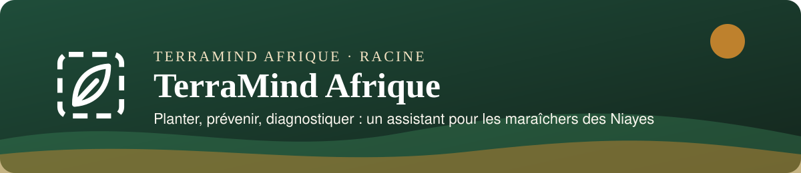
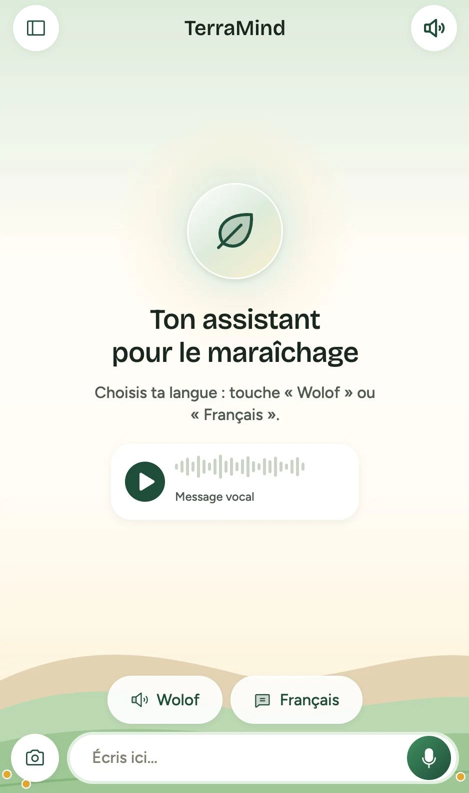
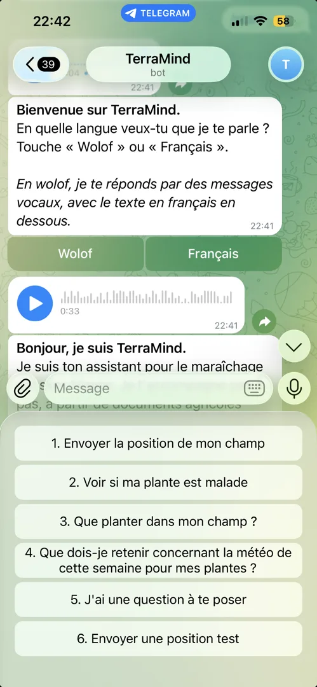
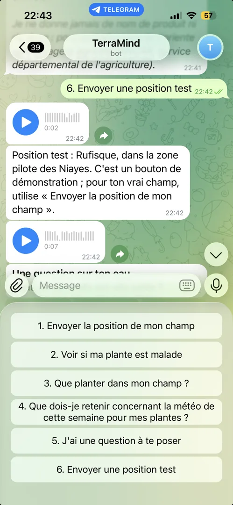
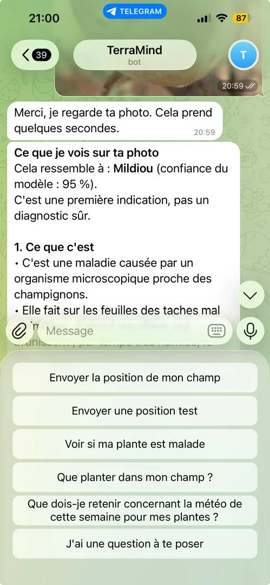
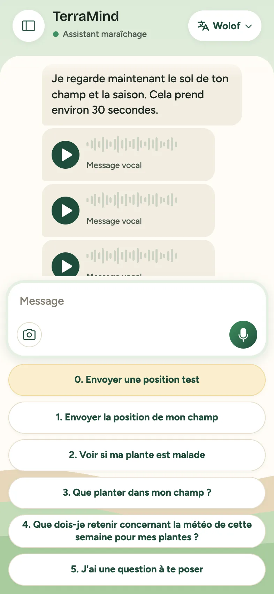
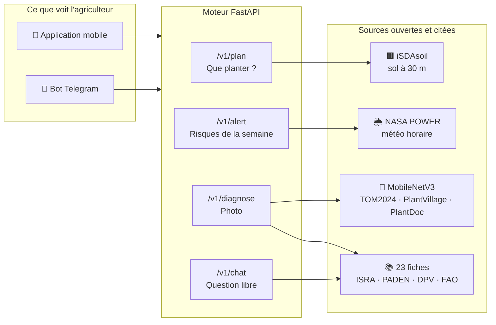

<p align="center"></p>

<p align="center">
  
  
  
</p>

<p align="center">
  <a href="https://terramind-afrique.vercel.app"></a>
  <a href="https://terramind-sigma.vercel.app"></a>
  <a href="https://t.me/TerraMindAfriqueBot"></a>
  <a href="https://expo.dev/artifacts/eas/dTPb8L2bq8-6MV-Uep3daUVLfiZ2tnf0YKwFA1Dtj-s.apk"></a>
</p>

<p align="center">
  <a href="https://terramind-afrique.vercel.app"><b>🌱 Ouvrir l'app en ligne</b></a>
  &nbsp;·&nbsp;
  <a href="https://t.me/TerraMindAfriqueBot"><b>💬 Essayer le bot Telegram</b></a>
  &nbsp;·&nbsp;
  <a href="channels/mobile/"><b>📱 L'application mobile</b></a>
  &nbsp;·&nbsp;
  <a href="https://terramind-sigma.vercel.app"><b>🌍 Le site</b></a>
  &nbsp;·&nbsp;
  <a href="docs/api.md"><b>⚙️ L'API</b></a>
</p>

<br>

<table>
<tr>
<td width="62%" valign="middle">

### Un agronome de poche pour les maraîchers des Niayes

Au Sénégal, un petit maraîcher décide seul : **quoi planter, quand traiter, quelle est cette tache sur la feuille**. Une erreur peut coûter une récolte.

TerraMind répond à ces trois questions sur l'application mobile et sur Telegram, **en français, et en wolof à l'oral** :

- 🌱 **Que planter ce mois-ci ?** d'après le sol lu au point de son champ
- 🔔 **Quel risque cette semaine ?** d'après la météo de sa zone
- 📷 **Quelle est cette maladie ?** d'après une simple photo

Chaque conseil **cite le document** d'où il vient. Quand TerraMind n'est pas sûr, il le dit.

</td>
<td width="38%" align="center">
  
</td>
</tr>
</table>

## 📱 L'application en action

> **Essayer tout de suite, sans rien installer :** [terramind-afrique.vercel.app](https://terramind-afrique.vercel.app) (la même application, dans le navigateur). Pas de plante malade sous la main ? Prends une de nos [photos d'essai](https://terramind-sigma.vercel.app/essai).

<table>
<tr>
<td align="center" width="25%"></td>
<td align="center" width="25%"></td>
<td align="center" width="25%"></td>
<td align="center" width="25%"></td>
</tr>
<tr>
<td align="center"><b>1 · Que planter</b><br><sub>8 cultures classées selon son sol et le mois</sub></td>
<td align="center"><b>2 · Les risques</b><br><sub>Mildiou, chenilles… d'après la météo</sub></td>
<td align="center"><b>3 · Le diagnostic</b><br><sub>Une photo, une maladie probable</sub></td>
<td align="center"><b>4 · L'explication</b><br><sub>Ce que c'est, pourquoi, que faire, comment éviter</sub></td>
</tr>
</table>

<sub>Vraies captures de l'application branchée sur le moteur en ligne, 21 nov 2026 : comme sur le bot, tout se passe dans la conversation. Profil de démonstration (position test de Rufisque, tomate). Photo du diagnostic : jeu de test de TOM2024 (CC BY 4.0), jamais vue à l'entraînement.</sub>

## 💬 Le bot Telegram en action

<table>
<tr>
<td align="center" width="25%"></td>
<td align="center" width="25%"></td>
<td align="center" width="25%"></td>
<td align="center" width="25%"></td>
</tr>
<tr>
<td align="center"><b>Il parle wolof</b><br><sub>Chaque message est aussi une note vocale</sub></td>
<td align="center"><b>Il répond à voix haute</b><br><sub>Notes vocales en wolof, texte en français dessous</sub></td>
<td align="center"><b>Sa photo</b><br><sub>La maladie expliquée en 4 temps</sub></td>
<td align="center"><b>Sa question</b><br><sub>Une réponse tirée des fiches, pages citées</sub></td>
</tr>
</table>

<sub>Vraies captures de <a href="https://t.me/TerraMindAfriqueBot">@TerraMindAfriqueBot</a> branché sur le moteur en ligne, 15, 16 et 17 nov 2026 (mode wolof : 17 nov). Position : bouton « position test » (Rufisque), pas celle d'un agriculteur. Toutes les captures : <a href="docs/assets/captures/">docs/assets/captures/</a>.</sub>

## 🗣️ Le wolof, à l'oral

<table>
<tr>
<td width="65%" valign="middle">

Beaucoup d'agriculteurs lisent peu. En mode wolof, TerraMind **parle** :

- sur **Telegram**, chaque message est aussi une **note vocale** ; l'agriculteur répond avec des **numéros** plutôt qu'en écrivant, et peut poser sa question **à voix haute** ;
- dans **l'application**, chaque réponse a son bouton **« Écouter en wolof »**, avec le texte wolof relu et le français dessous.

</td>
<td width="35%" align="center"><br><sub>Le plan, à écouter en wolof (application, 17 nov)</sub></td>
</tr>
</table>

<table>
<tr>
<td align="center" width="25%">🎙️<br><b>76 phrases</b><br><sub>traduites puis <b>relues une par une</b> par un locuteur de l'équipe, en wolof parlé</sub></td>
<td align="center" width="25%">🔊<br><b>76 notes vocales</b><br><sub>générées avec la voix wolof d'Octopus, la plateforme du concours</sub></td>
<td align="center" width="25%">👂<br><b>Questions orales</b><br><sub>reconnaissance vocale wolof, puis réponse tirée des fiches</sub></td>
<td align="center" width="25%">📖<br><b>Un lexique</b><br><sub>des termes agricoles choisis avec l'équipe : <a href="content/voix/">content/voix/</a></sub></td>
</tr>
</table>

## ⚙️ Comment ça marche : un moteur, deux façades



L'application et le bot n'ont **aucune logique agricole** : ils appellent le même moteur ([décision D1](docs/decisions.md)). C'est ce qui nous a permis de passer de WhatsApp à Telegram en quelques jours quand Meta a bloqué notre compte ([D12](docs/decisions.md), [récit complet](docs/difficultes.md)).

> [!TIP]
> **Analogie Kuroko no Basket** : le moteur est Kuroko. Il ne marque pas lui-même, ce sont les façades qui parlent à l'agriculteur ; mais c'est lui qui fait circuler chaque ballon vers le bon coéquipier (sol, météo, photo, fiches). Concrètement : une seule base de code agricole sert toutes les façades.

## 📊 Où en est le projet (17 nov 2026)

| | Brique | État | En chiffres |
|:-:|---|:-:|---|
| 🌱 | **Que planter** | ✅ | 8 cultures (tomate, pomme de terre, oignon, chou, poivron, carotte, piment, jaxatu) · guide ISRA 1987 · sol lu au point du champ |
| 🔔 | **Alertes météo** | ✅ | 7 risques : mildiou (tomate, pomme de terre, oignon), alternariose (tomate, carotte), mineuse, noctuelle, teigne · règles testées sur 2020-2025 |
| 📷 | **Diagnostic photo** | ✅ | **91,7 %** sur 1 058 photos de terrain africaines (TOM2024) · 21 problèmes reconnus · « je ne suis pas sûr » sous le seuil |
| 💬 | **Questions libres** | ✅ | 23 fiches sourcées · 3 vérifications indépendantes (≈ 320 affirmations, 51 corrigées) |
| 🗣️ | **Wolof** | ✅ | 76 phrases relues · 76 notes vocales, dans le bot et l'application · questions orales sur le bot |
| 📱 | **Application mobile** | ✅ | Expo · Android (APK) et web · français et wolof (notes vocales) |
| 💬 | **Bot Telegram** | ✅ | en ligne sur Render, même moteur que l'application |
| 🗄️ | WhatsApp | archivé | [archives/whatsapp/](archives/whatsapp/), à réactiver si le projet continue |

Détail des résultats du modèle : [ml/eval/](ml/eval/). Justification de chaque seuil : [docs/seuils-et-parametres.md](docs/seuils-et-parametres.md).

## 🧭 Explorer le dépôt

<table>
<tr>
<td width="25%" valign="top">⚙️ <a href="engine/"><b>engine/</b></a><br><sub>Le moteur : plan, alertes, diagnostic, questions, bot Telegram</sub></td>
<td width="25%" valign="top">💬 <a href="channels/"><b>channels/</b></a><br><sub>L'application mobile et le site vitrine</sub></td>
<td width="25%" valign="top">🚀 <a href="deploy/"><b>deploy/</b></a><br><sub>L'image Docker et Render</sub></td>
<td width="25%" valign="top">📝 <a href="content/"><b>content/</b></a><br><sub>23 fiches sourcées, voix et lexique wolof</sub></td>
</tr>
<tr>
<td width="25%" valign="top">🧠 <a href="ml/"><b>ml/</b></a><br><sub>Le modèle de diagnostic, évalué honnêtement</sub></td>
<td width="25%" valign="top">🗂️ <a href="data/"><b>data/</b></a><br><sub>Les données ouvertes et leur provenance</sub></td>
<td width="25%" valign="top">🔎 <a href="research/"><b>research/</b></a><br><sub>La base agronomique et les tests</sub></td>
<td width="25%" valign="top">📚 <a href="docs/"><b>docs/</b></a><br><sub>API, décisions D1 à D12, seuils, difficultés</sub></td>
</tr>
<tr>
<td width="25%" valign="top">🛠️ <a href="scripts/"><b>scripts/</b></a><br><sub>Les outils de collecte et de vérification</sub></td>
<td width="25%" valign="top">📊 <a href="dashboard/"><b>dashboard/</b></a><br><sub>Le tableau de bord (prévu, pas encore construit)</sub></td>
<td width="25%" valign="top">🗄️ <a href="archives/"><b>archives/</b></a><br><sub>Le bot WhatsApp mis de côté</sub></td>
</tr>
</table>

## 🤝 Nos règles

<table>
<tr>
<td align="center" width="25%">🚫<br><b>Rien de factice</b><br><sub>Ce qui est montré marche vraiment ; aucune donnée inventée (<a href="docs/decisions.md">D6</a>)</sub></td>
<td align="center" width="25%">📌<br><b>Toujours une source</b><br><sub>Sans source, le bot répond « je ne sais pas »</sub></td>
<td align="center" width="25%">🧪<br><b>Jamais de dose</b><br><sub>Pour un produit, il renvoie vers un agent agricole</sub></td>
<td align="center" width="25%">🔒<br><b>Vie privée</b><br><sub>Position arrondie à ~1 km ; aucune photo ni position d'agriculteur dans Git</sub></td>
</tr>
</table>

## 🚀 Lancer le projet en local

<details>
<summary><b>Moteur, application et site : les commandes</b></summary>

```bash
# 1. Moteur (Python 3.9 ou plus) : copier .env.example en .env puis remplir les clés
python3 -m venv .venv && .venv/bin/pip install -r engine/requirements.txt
.venv/bin/uvicorn engine.app.main:app --reload --port 8000
.venv/bin/python -m pytest -q                       # 70 tests

# 2. Application mobile (Node.js, Expo)
cd channels/mobile && npm install
npx expo start                     # QR code à scanner avec Expo Go, ou « w » pour le web

# 3. Site vitrine
cd channels/site && python3 -m http.server 5500
```

Le modèle de diagnostic (`modeles/diagnostic/`) n'est pas dans Git : il se reconstruit avec [ml/training/](ml/training/). En ligne, le moteur tourne sur **Render** à partir d'une image Docker ([deploy/](deploy/)).

</details>

## 👥 L'équipe

<table>
<tr>
<td align="center" width="33%"><b>Salam</b><br><sub>Chef de projet · moteur, façades, tableau de bord</sub><br><code>engine/</code> <code>channels/</code> <code>dashboard/</code></td>
<td align="center" width="33%"><b>Oscar</b><br><sub>IA et données · propriétaire du dépôt</sub><br><code>ml/</code> <code>data/</code></td>
<td align="center" width="33%"><b>Rama</b><br><sub>Contenu agronomique, tests utilisateurs, pitch</sub><br><code>content/</code> <code>research/</code></td>
</tr>
</table>

**Jalons 2026** : 3 nov fondations · 10 nov chaîne complète · 17 nov gel de la v1.0 · 22 nov livraison · 25 nov revue du jury · 10 déc finale. Plan de tâches : [docs/TACHES.md](docs/TACHES.md).

---

<p align="center"><sub>Code sous licence <a href="LICENSE">MIT</a> · les données et images gardent la licence de leur source (<a href="data/README.md">data/</a>) · <a href="CONTRIBUTING.md">Contribuer</a></sub></p>
