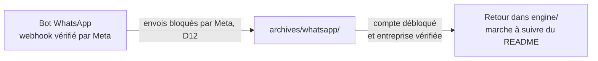

## En une phrase

Ce dossier garde le travail **mis de côté mais pas abandonné** : du code qui a fonctionné, débranché du moteur, avec la marche à suivre pour le reprendre.

| Dossier | Contenu | Pourquoi archivé | Reprendre |
|---|---|---|---|
| [`whatsapp/`](whatsapp/) | Webhook WhatsApp Cloud API (signature vérifiée, journaux de diagnostic), ses tests, ses variables | Meta a bloqué l'envoi des réponses : erreur 131031, compte restreint, entreprise non vérifiée ([docs/difficultes.md](../docs/difficultes.md)) | [whatsapp/README.md](whatsapp/README.md) |

Rien de ce dossier n'est chargé par le moteur ni inclus dans l'image Docker.
