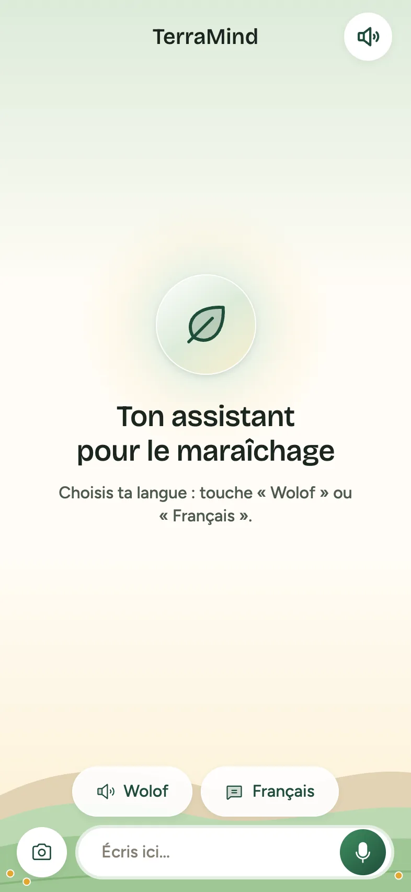
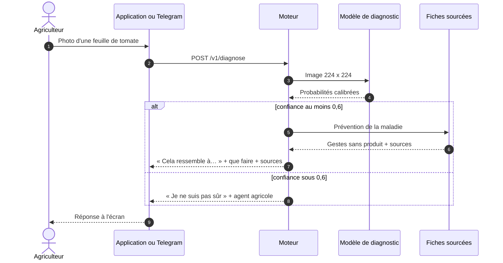

  
  
  

## En une phrase

Les façades sont les portes d'entrée de l'agriculteur. Elles transmettent sa demande au [moteur](../engine/) et affichent la réponse, **sans aucune logique agronomique** : tout le savoir est dans le moteur.

## L'application en images

        

Vraies captures de l'application branchée sur le moteur (écran d'iPhone 16, 393 × 852 points), 15 nov 2026. Bienvenue → langue → accueil → diagnostic → explication → plan → alertes. Photo du diagnostic : jeu de test de TOM2024 (CC BY 4.0), jamais vue à l'entraînement. Le visage des écrans de bienvenue et d'accueil est une image générée par IA.

## Les façades

| Façade | Pour qui | Comment on l'obtient | État |
|---|---|---|---|
| [**Application mobile**](mobile/) | Les agriculteurs | APK Android à télécharger par lien ou QR code ; version web à ajouter à l'écran d'accueil (iPhone compris), sans passer par les stores | ✅ Écrans branchés sur le moteur |
| **Bot Telegram** **@TerraMindAfriqueBot** | Les agriculteurs, et le jury pour la démonstration | Ouvrir Telegram et chercher le bot | ✅ Prêt. Code dans [engine/app/routes/telegram.py](../engine/app/routes/telegram.py), parce que c'est un webhook du moteur |
| [**Site vitrine**](site/) | Le public, le jury, les partenaires | Page web (hébergement Vercel), en français et en anglais | 🛠️ En cours de refonte, avec de vraies captures de l'application |
| Bot WhatsApp | La cible à terme | — | 🗄️ Archivé : [archives/whatsapp/](../archives/whatsapp/) |
| [`pwa/`](pwa/) | — | — | Remplacée par la version web de l'application mobile |

## Ce qu'il se passe quand l'agriculteur envoie une photo

## Pourquoi WhatsApp à terme, et Telegram pour la démonstration

Les maraîchers des Niayes utilisent WhatsApp tous les jours, y compris pour les notes vocales. C'était notre premier choix, et le webhook a fonctionné avec Meta. Mais l'envoi des réponses a été bloqué (erreur 131031, compte restreint, entreprise non vérifiée), sans délai garanti avant la livraison. La démonstration passe donc par l'application et Telegram, qui ne demande ni vérification d'entreprise ni paiement. Récit complet : [docs/difficultes.md](../docs/difficultes.md) ; décision : [D12](../docs/decisions.md).

## Sécurité

- Les jetons (`TELEGRAM_BOT_TOKEN`…) sont dans `.env`, **jamais dans le code ni dans Git** (modèle : [.env.example](../.env.example)).
- Le webhook Telegram refuse toute requête sans le bon secret (`TELEGRAM_WEBHOOK_SECRET`).
- L'application garde le profil de l'agriculteur **sur son téléphone seulement**, sans compte ni numéro.
- Aucune photo ni position GPS d'agriculteur n'est publiée ([research/consentement.md](../research/consentement.md)).

## Responsable

**Salam**. Voir [docs/TACHES.md](../docs/TACHES.md).
