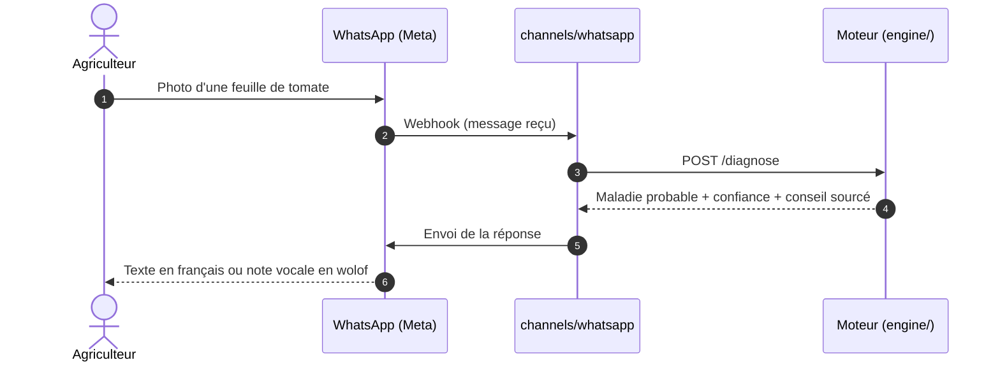

  
  
  

## En une phrase

Les façades sont les portes d'entrée de l'agriculteur. Elles transmettent sa question au [moteur](../engine/) et lui renvoient la réponse, **sans aucune logique agronomique** : tout le savoir est dans le moteur.

## Pourquoi WhatsApp à terme (et Telegram pour la démonstration)

Les maraîchers des Niayes utilisent déjà WhatsApp tous les jours, y compris pour les notes vocales. Rien à installer, rien à apprendre : on écrit, on parle ou on envoie une photo, comme à un voisin. Meta ayant bloqué notre compte (voir [docs/difficultes.md](../docs/difficultes.md)), la démonstration passe par l'application mobile et Telegram ; le code WhatsApp est gardé dans [archives/whatsapp/](../archives/whatsapp/).

## Ce qu'il se passe quand un agriculteur écrit

## Les deux façades

| Dossier | Façade | Pour qui | État |
|---|---|---|---|
| [`archives/whatsapp/`](../archives/whatsapp/) | Bot WhatsApp : webhook vérifié par Meta, signature contrôlée ; écho de démonstration | Les agriculteurs | 🗄️ Archivé le 13 nov (D12), à réactiver si le projet continue |
| `engine/app/routes/telegram.py` | Bot Telegram **@TerraMindAfriqueBot** : position → plan, photo → diagnostic, culture → alertes, question → fiches | Démonstration au jury | ✅ Prêt (13 nov) |
| [`mobile/`](mobile/) | App React Native (Expo) : APK Android téléchargeable et version web pour l'iPhone, sans passer par les stores | Les agriculteurs | ✅ Écrans branchés sur le moteur, nouvelle identité visuelle (13 nov) |
| [`pwa/`](pwa/) | Appli web installable sur le téléphone | Plan B si la validation de Meta tarde | 📅 Jalon J2 (10 nov) |

## Sécurité

- Les jetons Meta (`WHATSAPP_TOKEN`, etc.) sont dans `.env`, **jamais dans le code ni dans Git** (modèle : [`.env.example`](../.env.example)).
- Chaque webhook entrant est vérifié par sa signature (`WHATSAPP_APP_SECRET`).
- Aucune photo ni position GPS d'agriculteur n'est publiée (règles de [research/consentement.md](../research/consentement.md)).

## Responsable

**Salam**. Voir [docs/TACHES.md](../docs/TACHES.md).
