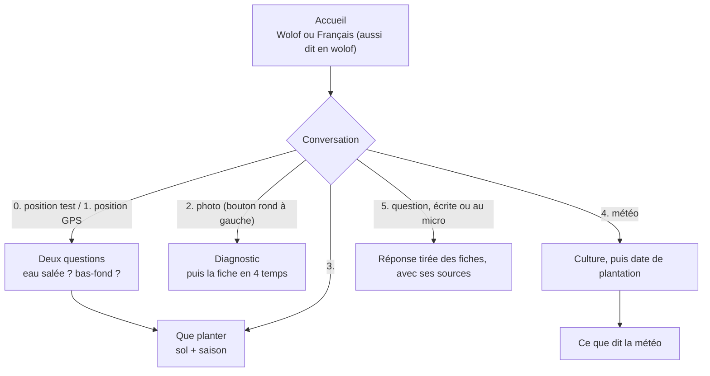

<p align="center"></p>

<p align="center">
  
  
  
</p>

<table>
<tr>
<td width="60%" valign="middle">

### Une action par écran, une grande image, une voix

L'application TerraMind est pensée pour des maraîchers **peu habitués aux écrans** : après le choix de la langue, **un seul écran, la conversation**, comme sur le bot Telegram. De grands boutons numérotés, chaque conseil avec sa source, et **en wolof, chaque réponse arrive aussi en message vocal**, lu tout seul.

Elle n'a aucune logique agricole : elle reprend le parcours du bot ([`src/conversation/bot.ts`](src/conversation/bot.ts), mêmes textes, mêmes notes vocales) et affiche ce que le [moteur](../../engine/) calcule.

</td>
<td width="40%" align="center"></td>
</tr>
</table>

## 📱 L'application en images

<table>
<tr>
<td align="center" width="25%"></td>
<td align="center" width="25%"></td>
<td align="center" width="25%"></td>
<td align="center" width="25%"></td>
</tr>
<tr>
<td align="center"><b>La conversation</b><br><sub>Bulles, grands boutons, voix</sub></td>
<td align="center"><b>Que planter</b><br><sub>Selon le sol et le mois</sub></td>
<td align="center"><b>Alertes</b><br><sub>D'après la météo de la zone</sub></td>
<td align="center"><b>Diagnostic</b><br><sub>La photo, puis la fiche en 4 temps</sub></td>
</tr>
</table>

<sub>Vraies captures de l'application branchée sur le moteur en ligne (393 × 852 points), 21 nov 2026. Photo du diagnostic : jeu de test de TOM2024 (CC BY 4.0), jamais vue à l'entraînement. Le paysage du bas de l'écran est un dessin vectoriel.</sub>

## 🗣️ En wolof

Si l'agriculteur choisit **Wolof**, chaque réponse du bot est précédée de ses **notes vocales wolof relues par un locuteur** (les mêmes fichiers que le bot Telegram, servis par le moteur sur `/audio/wo/`). Elles se lisent **toutes seules**, l'une après l'autre ; on peut toucher une bulle pour la réécouter. Le texte français suit, écrit. Les grands boutons portent un numéro (0 à 5), que les notes vocales citent (« appuie sur le deux »). Une question dite au micro reçoit une réponse dite en wolof (Octopus).

## 🧭 Le parcours



Le bouton de langue en haut à droite (« Français ▾ » / « Wolof ▾ ») repose la question de la langue. La conversation est gardée sur le téléphone ; écrire `/oublier` efface tout.

## 🎨 Les choix de conception (et d'où ils viennent)

| Choix | Pourquoi | Source |
|---|---|---|
| Un seul écran : la conversation, comme le bot | Qui ne lit pas le français n'a besoin que des boutons et de la voix ; le reste était illisible pour lui | Retour de Salam (21 nov 2026) |
| Grands boutons numérotés sous la case « Message », bouton photo rond tout à gauche, micro à droite | C'est exactement ce que disent les notes vocales wolof (enregistrées pour Telegram) | Notes vocales `accueil`, `conseils_photo`, `invite_question` |
| Notes vocales lues automatiquement | Un agriculteur qui ne lit pas ne doit pas avoir à deviner qu'il faut toucher « lecture » | Projet |
| Cibles tactiles ≥ 44 px, 8 px entre elles ; lignes équilibrées sans mot seul | Utilisateurs peu habitués aux écrans | Skill ui-ux-pro-max (règles d'accessibilité) |
| Mise en page d'après la maquette « Money AI » (Dribbble), aux couleurs de TerraMind | Choisie par Salam ; comparée en 4 tours par un relecteur indépendant (9,5 et 9 sur 10) | `docs/maquettes/inspiration/` (non versionné) |
| Résultat « je ne suis pas sûr » assumé | Mieux vaut orienter vers un agent qu'inventer | Règle du projet (D6, D8) |

**Identité visuelle « Terre des Niayes »** : sable, vert forêt, pousse, terre cuite et soleil (contrastes vérifiés), polices Bricolage Grotesque et Figtree, icônes Phosphor, paysage des Niayes dessiné en bas de l'écran. Couleurs dans [`src/theme.ts`](src/theme.ts).

## 🗂️ Organisation du code

| Chemin | Contenu |
|---|---|
| [`src/app/index.tsx`](src/app/index.tsx) | L'unique écran : accueil (langue), puis la conversation (bulles, saisie, photo, micro, grands boutons) |
| [`src/conversation/bot.ts`](src/conversation/bot.ts) | Le parcours du bot Telegram, porté tel quel (textes, boutons, notes vocales) |
| [`src/conversation/notes-vocales.ts`](src/conversation/notes-vocales.ts) | Liste des notes vocales disponibles (générée : `python3 scripts/outils/lister_notes_vocales.py`) |
| [`src/api.ts`](src/api.ts) | Appels au moteur (`/v1/plan`, `/v1/alert`, `/v1/diagnose`, `/v1/chat`, `/v1/chat/vocal`) |
| [`src/profil.ts`](src/profil.ts) | Ce que l'agriculteur a indiqué et la conversation, gardés **sur le téléphone seulement** |
| [`src/components/`](src/components/) | Texte des bulles (gras, italique, espaces insécables), lecteur des notes vocales, paysage |

## 🚀 Lancer et tester

```bash
cd channels/mobile
npm install
echo "EXPO_PUBLIC_ENGINE_URL=http://<ip-du-mac>:8000" > .env.local   # adresse du moteur
npx expo start --port 8090        # scanner le QR code avec Expo Go (Android), ou « w » pour le web
npx tsc --noEmit && npx expo lint # vérifications
```

Sans `EXPO_PUBLIC_ENGINE_URL`, l'application appelle `http://localhost:8000` (le moteur lancé sur le même ordinateur, utile pour la version web).

**📱 Télécharger l'APK (21 nov 2026)** : https://expo.dev/artifacts/eas/OO1sW--g6e6t1s-py-e6aFsvLpcxVs5uVj99fmxZRV0.apk (à ouvrir sur un téléphone Android ; autoriser l'installation depuis le navigateur).

**Distribution sans store** :
- **Android** : APK fabriqué avec EAS Build, partagé par lien ou QR code. Le profil `apk` de [`eas.json`](eas.json) produit un APK (pas un AAB) qui appelle le moteur en ligne (`https://terramind-moteur.onrender.com`) :
  ```bash
  npx eas-cli@latest login                              # compte Expo de Salam (pas de compte d’équipe)
  npx eas-cli@latest build -p android --profile apk     # compilation dans le cloud, lien de téléchargement à la fin
  ```
  Le moteur gratuit de Render s'endort après une période sans visite : la première requête peut prendre environ une minute.
- **iPhone** : la version web, à ajouter à l'écran d'accueil. Apple n'autorise pas l'installation libre d'une application sans compte développeur payant.

## ⚠️ Limites actuelles

- Une question **écrite** en wolof reçoit une réponse écrite seulement (le moteur ne fait la voix que pour les questions dites au micro, `/v1/chat/vocal`).
- La conversation ne garde pas la mémoire des échanges précédents côté moteur (`/v1/chat` ne la reçoit pas), contrairement au bot Telegram.
- Pas encore de notifications : les alertes météo se demandent avec le bouton 4.

## 👤 Responsable

**Salam**.
