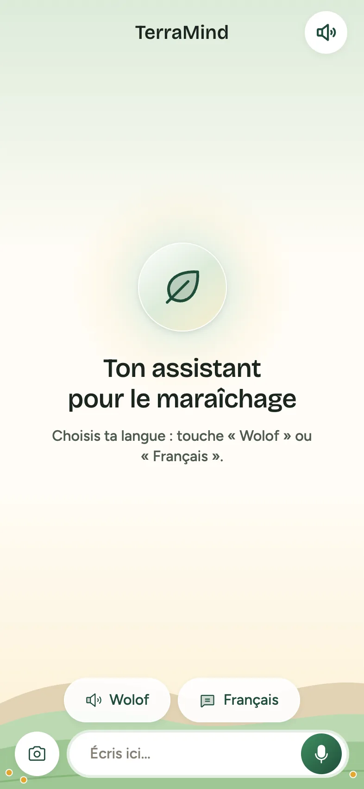
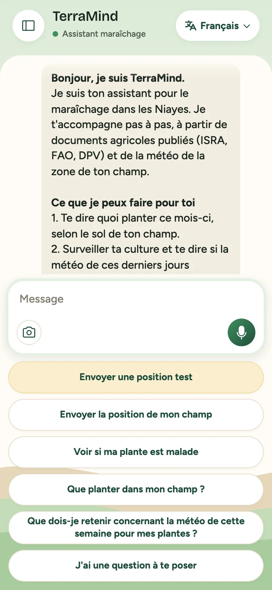
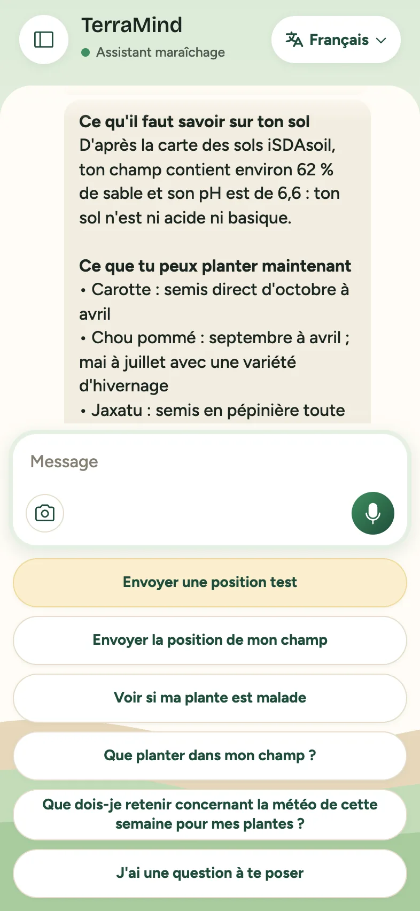
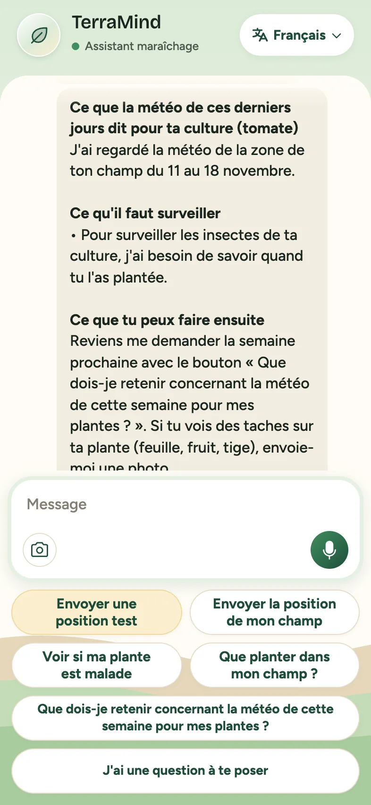
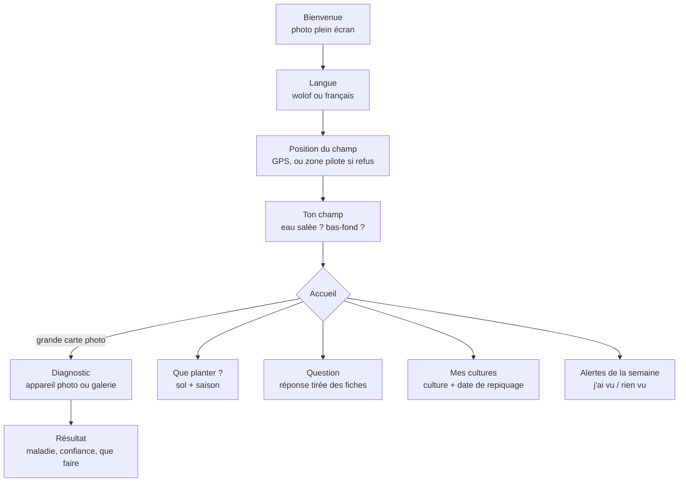

<p align="center"></p>

<p align="center">
  
  
  
</p>

<table>
<tr>
<td width="60%" valign="middle">

### Une action par écran, une grande image, une voix

L'application TerraMind est pensée pour des maraîchers **peu habitués aux écrans** : de grandes icônes, un seul geste par écran, chaque conseil avec sa source, et **en wolof, chaque réponse se dit à voix haute**.

Elle n'a aucune logique agricole : elle affiche ce que le [moteur](../../engine/) calcule.

</td>
<td width="40%" align="center"></td>
</tr>
</table>

## 📱 L'application en images

<table>
<tr>
<td align="center" width="25%"></td>
<td align="center" width="25%"></td>
<td align="center" width="25%"></td>
<td align="center" width="25%"></td>
</tr>
<tr>
<td align="center"><b>Accueil</b><br><sub>L'appareil photo au centre</sub></td>
<td align="center"><b>Que planter</b><br><sub>Selon le sol et le mois</sub></td>
<td align="center"><b>Alertes</b><br><sub>D'après la météo de la zone</sub></td>
<td align="center"><b>Diagnostic</b><br><sub>Sa photo, en grand, et le verdict</sub></td>
</tr>
</table>

<sub>Vraies captures de l'application branchée sur le moteur (iPhone 16, 393 × 852 points), 15 nov 2026. Photo du diagnostic : jeu de test de TOM2024 (CC BY 4.0), jamais vue à l'entraînement. Le visage des écrans de bienvenue et d'accueil est une image générée par IA.</sub>

## 🗣️ En wolof

Si l'agriculteur choisit **Wolof** au premier écran, le moteur renvoie les **phrases wolof relues par un locuteur** et leurs **notes vocales** (les mêmes que le bot Telegram) :

| Écran | Ce qu'il entend en appuyant sur 🔊 |
|---|---|
| Que planter | l'introduction, puis chaque culture conseillée ou possible |
| Alertes | « rien d'inquiétant », ou chaque risque de la semaine |
| Résultat | la fiche de la maladie en court, puis la phrase de prudence |

Le haut-parleur de l'en-tête lit tout l'écran ; chaque carte a aussi son petit bouton « Écouter ». Le texte français reste écrit dessous. Sans note vocale (en français), le haut-parleur n'apparaît pas. Code : [`src/components/Voix.tsx`](src/components/Voix.tsx).

## 🧭 Le parcours



Les 3 écrans de première ouverture ne s'affichent qu'une fois. Ensuite, l'application s'ouvre directement sur l'accueil.

## 🎨 Les choix de conception (et d'où ils viennent)

| Choix | Pourquoi | Source |
|---|---|---|
| Accueil centré sur l'appareil photo | Le geste le plus utile doit être le plus visible | Plantix, PictureThis ([références d'écrans](../../docs/maquettes/references-ecrans.md)) |
| Une action par écran, pas de menus imbriqués | Les utilisateurs peu lettrés évitent la navigation hiérarchique | Microsoft Research, interfaces sans texte |
| Icônes + couleur + mot sur chaque badge | Ne jamais compter sur la couleur seule | Règles d'accessibilité |
| Position demandée **après** une explication, avec une liste de zones si refus | La fenêtre système brute fait refuser | Analyse de parcours (screensdesign) |
| Résultat « je ne suis pas sûr » assumé | Mieux vaut orienter vers un agent qu'inventer | Règle du projet (D6, D8) |

**Identité visuelle « Terre des Niayes »** : sable, vert forêt et terre cuite (contrastes vérifiés), polices Bricolage Grotesque et Figtree, icônes Phosphor bicolores, apparitions douces et boutons « à ressort ». Le tout est défini dans [`src/theme.ts`](src/theme.ts) et [`src/components/ui.tsx`](src/components/ui.tsx).

## 🗂️ Organisation du code

| Chemin | Contenu |
|---|---|
| [`src/app/`](src/app/) | Un fichier par écran (Expo Router) : `bienvenue/`, `accueil`, `plan`, `cultures`, `diagnostic/`, `alertes`, `question` |
| [`src/api.ts`](src/api.ts) | Appels au moteur (`/v1/plan`, `/v1/alert`, `/v1/diagnose`, `/v1/chat`, `/v1/feedback`) |
| [`src/profil.ts`](src/profil.ts) | Ce que l'agriculteur a indiqué, gardé **sur le téléphone seulement** ; zones pilotes et cultures |
| [`src/components/`](src/components/) | Cadre d'écran, boutons, cartes, chargement animé, sources, feuille glissante, lecteur des notes vocales wolof |
| [`src/format.ts`](src/format.ts) | Nombres et dates à la française |
| [`assets/illustrations/`](assets/illustrations/) | Photo d'accueil (générée par IA et signalée comme telle : [CREDITS.md](assets/illustrations/CREDITS.md)) |

## 🚀 Lancer et tester

```bash
cd channels/mobile
npm install
echo "EXPO_PUBLIC_ENGINE_URL=http://<ip-du-mac>:8000" > .env.local   # adresse du moteur
npx expo start --port 8090        # scanner le QR code avec Expo Go (Android), ou « w » pour le web
npx tsc --noEmit && npx expo lint # vérifications
```

Sans `EXPO_PUBLIC_ENGINE_URL`, l'application appelle `http://localhost:8000` (le moteur lancé sur le même ordinateur, utile pour la version web).

**📱 Télécharger l'APK (18 nov 2026)** : https://expo.dev/artifacts/eas/p6j-J18atqTvTXm98FDXBm7MMHqNiEscckr8-74V0SE.apk (à ouvrir sur un téléphone Android ; autoriser l'installation depuis le navigateur).

**Distribution sans store** :
- **Android** : APK fabriqué avec EAS Build, partagé par lien ou QR code. Le profil `apk` de [`eas.json`](eas.json) produit un APK (pas un AAB) qui appelle le moteur en ligne (`https://terramind-moteur.onrender.com`) :
  ```bash
  npx eas-cli@latest login                              # compte Expo de Salam (pas de compte d’équipe)
  npx eas-cli@latest build -p android --profile apk     # compilation dans le cloud, lien de téléchargement à la fin
  ```
  Le moteur gratuit de Render s'endort après une période sans visite : la première requête peut prendre environ une minute.
- **iPhone** : la version web, à ajouter à l'écran d'accueil. Apple n'autorise pas l'installation libre d'une application sans compte développeur payant.

## ⚠️ Limites actuelles

- En wolof, les questions libres (écran Question) reçoivent encore une réponse écrite en français ; le bot Telegram, lui, accepte les questions orales en wolof.
- La lecture des notes vocales utilise `expo-audio` : l'APK doit être recompilé (EAS) pour l'inclure.
- Les retours « j'ai vu / rien vu » sont envoyés au moteur, qui ne les stocke pas encore.
- Les alertes s'affichent dans l'application. Pas encore de notifications : l'écran qui les demandait a été retiré (16 nov) tant qu'aucune n'est réellement envoyée.

## 👤 Responsable

**Salam**.
