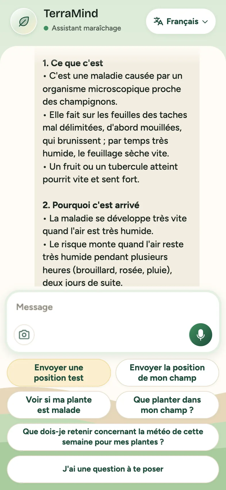

<p align="center"></p>

<p align="center">
  
  
  
</p>

## En une phrase

La page qui présente TerraMind au public et au jury : ce que fait l'assistant, de vraies captures de l'application, les sources, la FAQ, et les liens vers le bot Telegram et l'application Android.

## Les captures de l'application

Les images de [`captures/`](captures/) sont de **vraies captures** de l'application, branchée sur le moteur, à la taille d'un écran d'iPhone 16 (393 × 852 points).

<p align="center">
  
  
  
  
  
</p>

- Profil de démonstration : Rufisque, tomate plantée le 20 octobre. Aucune donnée réelle d'agriculteur.
- Photo du diagnostic : mildiou de la tomate tirée du **jeu de test** de TOM2024 (CC BY 4.0), jamais vue par le modèle à l'entraînement. Le modèle répond « Mildiou, 93 % ».
- Le visage des écrans de bienvenue et d'accueil est une **image générée par IA** (voir [`channels/mobile/assets/illustrations/CREDITS.md`](../mobile/assets/illustrations/CREDITS.md)).

**Refaire les captures** quand l'application change : la marche à suivre est en tête de [`outils/captures.js`](outils/captures.js).

## Lancer en local

```bash
cd channels/site && python3 -m http.server 5500   # puis http://127.0.0.1:5500
```

## Modifier le style

Le style est compilé une fois par la CLI Tailwind v3 (le « Play CDN » de Tailwind n'est pas fait pour la production) :

```bash
cd channels/site && npx tailwindcss@3 -c tailwind.config.js -i src.css -o site.css --minify
```

À relancer après chaque changement de classes dans `index.html` ou dans `src.css`. Le fichier `site.css` produit (environ 31 Ko) est commité.

## Deux langues

Le français est écrit dans le HTML, l'anglais dans l'attribut `data-en` de chaque élément (et dans les tableaux `FONCTIONS`, `FAQ`, `FICHES` du script). Le choix est gardé dans le navigateur ; l'adresse `/en` ouvre directement l'anglais (réécriture dans [`vercel.json`](vercel.json)). Les balises `hreflang` seront ajoutées quand l'adresse définitive du site sera connue.

## Choix de conception

- Skill ui-ux-pro-max : landing « app store » centrée sur de vraies captures, Outfit (titres) et Work Sans (texte), jaune soleil pour l'action principale.
- Recommandations de NN/g, Google, Apple, W3C et web.dev (recherche du 15 nov 2026) : pas de carrousel automatique, pas de badge de store sans app sur le store, animations en `transform`/`opacity` seulement, coupées si le visiteur demande moins de mouvement, zones tactiles d'au moins 44 px.
- Composants inspirés de 21st.dev, refaits en HTML sans React : barre flottante, téléphone synchronisé avec la liste des fonctions (« features with panel »), grille « bento », FAQ à ouverture unique, sélecteur de langue en pilule.

## Mise en ligne sur Vercel

Nouveau projet Vercel relié au dépôt, **Root Directory : `channels/site`**, aucun réglage de build. Le bouton « Télécharger l'app » reste en « bientôt disponible » tant que `APK_URL` est vide dans le script de la page.

## Règles

- Rien d'inventé : pas de faux avis, pas de fausses notes, pas de compteurs. Chaque chiffre affiché vient du dépôt (23 fiches, 20 problèmes reconnus, 8 cultures).
- Pas de badge Google Play ni App Store tant que l'application n'est pas sur ces stores (règles de Google et d'Apple).
