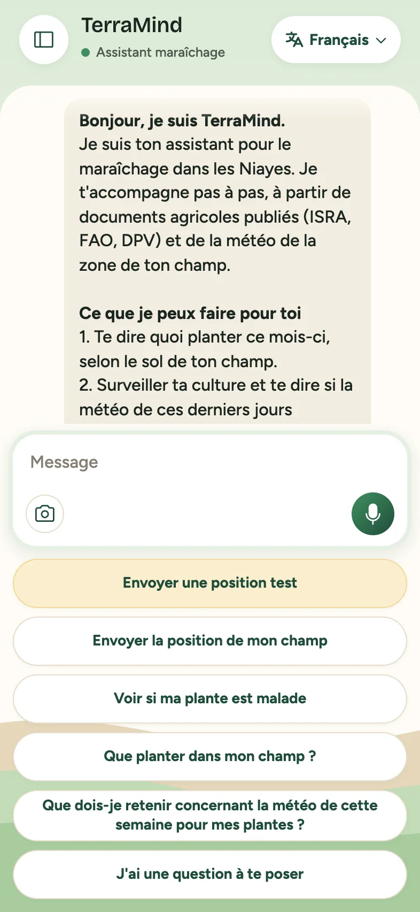
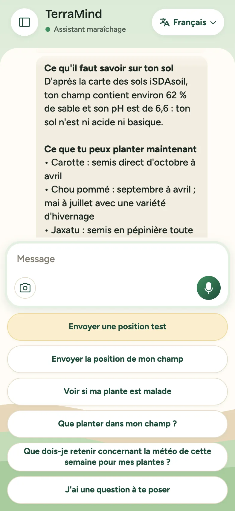

<p align="center"></p>

<p align="center">
  
  
  
</p>

## En une phrase

La page qui présente TerraMind au public et au jury : ce que fait l'assistant, de vraies captures de l'application, les sources, la FAQ, et les liens vers le bot Telegram et l'application Android.

## Les captures de l'application

Les images de [`captures/`](captures/) sont de **vraies captures** de l'application, branchée sur le moteur, à la taille d'un écran d'iPhone 16 (393 × 852 points).

<p align="center">
  
  
  
  
  
</p>

- Profil de démonstration : Rufisque, tomate plantée le 20 octobre. Aucune donnée réelle d'agriculteur.
- Photo du diagnostic : mildiou de la tomate tirée du **jeu de test** de TOM2024 (CC BY 4.0), jamais vue par le modèle à l'entraînement. Le modèle répond « Mildiou, 93 % ».
- Le visage des écrans de bienvenue et d'accueil est une **image générée par IA** (voir [`channels/mobile/assets/illustrations/CREDITS.md`](../mobile/assets/illustrations/CREDITS.md)).

**Refaire les captures** quand l'application change : la marche à suivre est en tête de [`outils/captures.js`](outils/captures.js).

## Lancer en local

```bash
cd channels/site && python3 -m http.server 5500   # puis http://127.0.0.1:5500
```

## Mise en ligne sur Vercel

Nouveau projet Vercel relié au dépôt, **Root Directory : `channels/site`**, aucun réglage de build. Le bouton « Télécharger l'app » reste en « bientôt disponible » tant que `APK_URL` est vide dans le script de la page.

## Règles

- Rien d'inventé : pas de faux avis, pas de fausses notes, pas de compteurs. Chaque chiffre affiché vient du dépôt (23 fiches, 20 problèmes reconnus, 8 cultures).
- Pas de badge Google Play ni App Store tant que l'application n'est pas sur ces stores (règles de Google et d'Apple).
