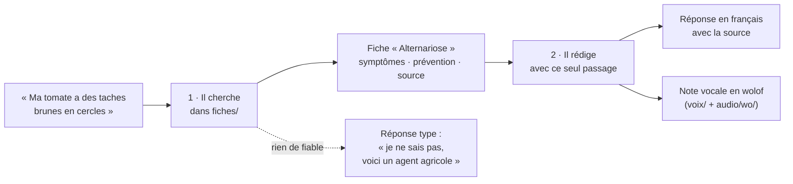

  
  
  

## En une phrase

Ce dossier est **la mémoire du bot** : il ne répond qu'à partir de ce qui est écrit ici. Si une information n'est pas dans une fiche, le bot dit « je ne sais pas » au lieu d'inventer.

## Comment le bot s'en sert

C'est le principe du **RAG** (génération à partir de documents) : un examen à livre ouvert, avec nos fiches pour seul livre ([décision D8](../docs/decisions.md)).

## Ce qu'il contient

| Dossier | Contenu | État |
|---|---|---|
| [`fiches/`](fiches/) | Une fiche par culture et par maladie : symptômes, prévention **sans produit**, saison, source page par page | ✍️ En rédaction par Rama |
| [`templates/`](templates/) | **Réponses types** : messages courts envoyés mot pour mot (accueil, « je ne sais pas », diagnostic incertain, alerte) | ✍️ En rédaction |
| [`voix/lexique_wolof.csv`](voix/lexique_wolof.csv) | Carnet de prononciation pour la voix wolof : nombres, mois, unités, cultures, mots du champ | ✅ 38 entrées sourcées (à valider par un locuteur), 27 à remplir |
| [`audio/wo/`](audio/wo/) | Réponses types sensibles **enregistrées par une voix humaine** en wolof | 📅 12 novembre |

## D'où vient le contenu

Uniquement des documents publics et identifiés, listés avec leurs pages :
- *Guide pratique du maraîchage au Sénégal* (ISRA, CDH, FAO, 1987) ;
- livret du ministère de l'Agriculture sur l'oignon dans les Niayes (2022, français et wolof) ;
- documents de la FAO, du projet STDF sur le chou des Niayes, et du CNRADA (Mauritanie) quand le Sénégal ne dit rien.

Le détail est dans [research/itineraires-par-culture.md](../research/itineraires-par-culture.md) et [docs/sources/](../docs/sources/).

## Les règles d'or d'une fiche

1. **Rien d'inventé** : chaque phrase a une source (document et page).
2. **Jamais de nom de pesticide ni de dose.** Le bot oriente vers un agent agricole pour tout traitement.
3. **Une information d'un autre pays est signalée** (« d'après une fiche de Mauritanie »), et seulement si la zone ressemble aux Niayes pour ce type d'information.
4. **Écrite pour l'oreille** quand elle sera lue en wolof : phrases courtes, nombres en toutes lettres, pas de symboles.

## Exemple : une entrée du lexique

| Écrit | Dit en wolof | Source | Statut |
|---|---|---|---|
| oignon | soble | Livret PIESAN oignon, ministère de l'Agriculture 2022, p. 3 | à valider par un locuteur |
| novembre | Noovambar | idem, p. 3 | à valider par un locuteur |

## Responsable

**Rama** (contenu, réponses types, voix), avec Salam pour la voix wolof. Voir [docs/TACHES.md](../docs/TACHES.md).
