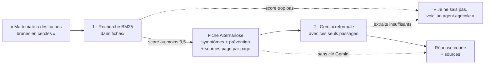

  
  
  

## En une phrase

Ce dossier est **la mémoire du bot** : il ne répond qu'à partir de ce qui est écrit ici. Si une information n'est pas dans une fiche, le bot dit « je ne sais pas » au lieu d'inventer.

## Comment le bot s'en sert (RAG)

C'est un **examen à livre ouvert**, avec nos fiches pour seul livre ([décision D8](../docs/decisions.md)). Le seuil de 3,5 vient d'une mesure sur 20 questions : 10 questions agricoles entre 4,0 et 11,6, 10 questions hors sujet entre 0 et 3,3 ([docs/seuils-et-parametres.md](../docs/seuils-et-parametres.md)).

> **Analogie Kuroko no Basket** : Riko prépare chaque match avec les données de l'adversaire, jamais au hasard. Le bot fait pareil : il ne « joue » qu'avec ce que les fiches contiennent. Concrètement, Gemini reçoit uniquement les passages trouvés et doit répondre « je ne sais pas » s'ils ne suffisent pas.

## Ce qu'il contient

| Dossier | Contenu | État |
|---|---|---|
| [`fiches/`](fiches/) | 23 fiches : maladies (alternariose, mildiou, cladosporiose, tache bactérienne, viroses, fusariose, flétrissement bactérien, septoriose, tache cible), ravageurs (mineuse, teigne du chou, acariens, noctuelle, chenilles de l'oignon, nématodes, thrips), accidents (cul noir, coup de soleil), cultures (tomate, oignon, chou, pomme de terre, poivron et carotte), sol et sel. Chaque problème que le modèle photo reconnaît a sa fiche. Chaque phrase porte sa référence (`[G87 p. 140]`), expliquée dans [`_SOURCES.md`](fiches/_SOURCES.md). | ✅ Vérifiées |
| [`voix/lexique_wolof.csv`](voix/lexique_wolof.csv) | Carnet de prononciation pour la voix wolof : nombres, mois, unités, cultures, mots du champ | ✅ Entrées sourcées, à valider par un locuteur |
| [`voix/controle_voix.csv`](voix/controle_voix.csv) | Résultat du contrôle automatique voix → texte de chaque mot (fiable, à risque, non testé) | ✅ |
| [`templates/`](templates/) | Réponses types envoyées mot pour mot | 📅 Vide |
| [`audio/wo/`](audio/wo/) | Réponses sensibles enregistrées par une voix humaine en wolof | 📅 Vide |

## Une vérification indépendante

Chaque fiche a été relue par un agent de vérification indépendant, phrase par phrase, contre les PDF sources (13 nov 2026), en trois passes :

| Passe | Fiches | Affirmations | Confirmées | Corrigées | Invérifiables |
|---|---|---|---|---|---|
| 1 | les 14 premières | environ 150 | 118 | 25 | 7 |
| 2 | 7 nouvelles + 5 réorganisées | 129 | 106 | 21 | 2 |
| 3 | septoriose, tache cible, flétrissement bactérien | 44 | 39 | 5 | 0 |

Erreurs typiques trouvées : pages fausses, un mot absent de la source (« taches huileuses »), un vecteur généralisé à tort (la mouche blanche pour tous les virus), un contresens (« regarder » au lieu de « traiter » le dessous des feuilles). Les corrections sont dans l'historique Git. Les fiches restent à relire par Rama.

## D'où vient le contenu

Uniquement des documents publics et identifiés :
- *Guide pratique du maraîchage au Sénégal* (ISRA, CDH, FAO, 1987) ;
- livrets PADEN et PIESAN des Niayes (oignon, chou, pomme de terre), en français et en wolof ;
- manuel de la DPV sur les ravageurs et maladies des Niayes ;
- documents FAO/RADHORT et KCOA, rapport STDF sur le chou ;
- fiches du CNRADA (Mauritanie) quand le Sénégal ne dit rien.

Le détail est dans [research/](../research/) et [docs/sources/](../docs/sources/).

## Les règles d'une fiche

1. **Rien d'inventé** : chaque phrase a une source (document et page).
2. **Jamais de nom de pesticide ni de dose** : pour tout traitement, le bot oriente vers un agent agricole.
3. **Une information d'un autre pays est signalée**, et seulement si la zone ressemble aux Niayes.
4. **Les désaccords entre sources sont montrés**, pas tranchés en silence (exemple : la variété Xina face aux nématodes, 1987 contre 2012).
5. **Écrite pour l'oreille** quand elle sera lue en wolof : phrases courtes, nombres en toutes lettres.

## Ajouter ou corriger une fiche

1. Créer `fiches/<type>-<sujet>.md`, avec l'en-tête `id`, `titre`, `cultures`, `type`, `statut`.
2. Pour une maladie, un ravageur ou un accident, ces sections, dans l'ordre où un malade se pose les questions :
   - `## Ce que c'est`
   - `## Comment la reconnaître`
   - `## Pourquoi c'est arrivé`
   - `## Que faire maintenant`
   - `## Pour que ça ne revienne pas`

   Les 4 sections autres que « Comment la reconnaître » sont montrées après un diagnostic photo, en 4 cartes numérotées. Ajouter `## Au Sénégal` si une source locale existe, ou dire qu'il n'y en a pas. Une ligne réservée à une culture commence par « Oignon : » ou « Sur la tomate : » : l'app ne la montre que pour cette culture. Ajouter la correspondance étiquette → fiche dans `FICHES_ETIQUETTES` (`engine/app/routes/v1.py`).
3. Mettre une référence entre crochets à la fin de chaque phrase, et ajouter l'abréviation dans `_SOURCES.md` si elle est nouvelle.
4. Le moteur relit les fiches à son démarrage.

## Responsables

**Rama** (contenu), avec **Salam** (RAG, voix wolof).
