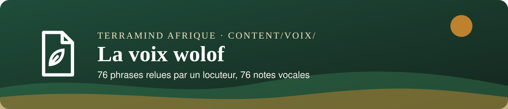
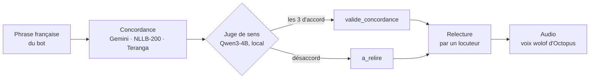

  
  
  

Les phrases que TerraMind dit **à voix haute en wolof** (bot Telegram et application), pour les agriculteurs qui ne lisent pas. **Les 76 phrases ont été relues une par une par un locuteur de l'équipe (17 nov 2026)**, en wolof parlé plutôt qu'en traduction mot à mot ; les notes vocales sont dans [`content/audio/wo/`](../audio/wo/).

## 📁 Les fichiers

| Fichier | Contenu |
|---|---|
| [`messages_wolof.csv`](messages_wolof.csv) | Le catalogue : une ligne par phrase (`cle`, `usage`, `voix`, `texte_fr`, `texte_wo`, `statut`, `relu_par`). Créé par `scripts/outils/creer_catalogue_wolof.py`. |
| [`lexique_wolof.csv`](lexique_wolof.csv) | Les mots imposés aux traductions (glossaire : cultures, maladies, boutons). |
| [`controle_voix.csv`](controle_voix.csv) | Le contrôle « aller-retour » : synthèse vocale, puis transcription, comparées au texte de départ. |
| [`prononciation_voix.csv`](prononciation_voix.csv) | Ce que la voix d'Octopus doit dire à la place de certains mots (« tool » → « taul »), choisi à l'écoute par un locuteur ; l'écran garde l'orthographe officielle. |
| [`enregistrements/`](enregistrements/) | La prononciation de référence enregistrée par Salam ; « position reçue » est dite avec sa propre voix. |
| `traductions_concordance.csv` | Le détail de la traduction par concordance (les 3 versions, leurs retraductions et l'avis du juge). |

## 🔀 Le chemin d'une phrase

**Statuts** : `a_traduire`, `brouillon_gemini`, `a_relire`, `valide_concordance`, `relu` (relu par un locuteur : plus jamais modifié automatiquement).

**Limite constatée le 15 nov 2026** : les retraductions automatiques du wolof vers le français sont trop peu fiables pour valider seules. La concordance sert surtout à proposer 3 versions par phrase au locuteur qui relit. Aucun audio n'est généré pour une phrase qui n'a pas été relue ou validée.
