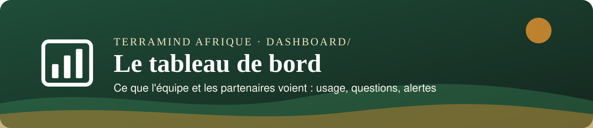
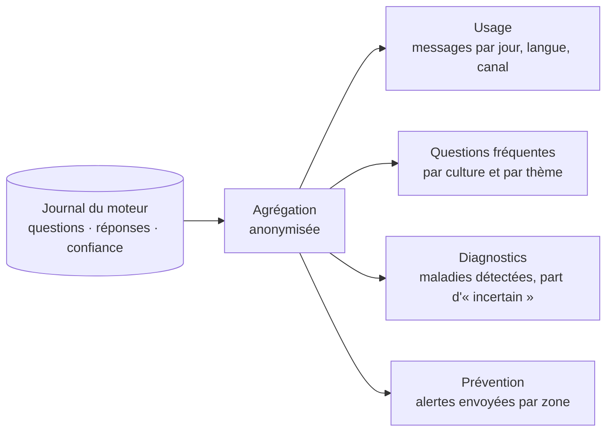

  

## En une phrase

Le tableau de bord montre à l'équipe et aux partenaires (ANCAR, organisations de producteurs) **comment l'outil est utilisé** et **ce qui inquiète les agriculteurs**, sans jamais exposer de donnée personnelle.

## Ce qu'il montrera

| Indicateur | Pourquoi il compte |
|---|---|
| Part des réponses « je ne sais pas » ou « incertain » | Montre où il manque des fiches ou des images |
| Maladies et ravageurs les plus signalés, par semaine | Signal précoce pour les agents agricoles |
| Langue et canal utilisés | Vérifie que le wolof vocal sert vraiment |
| Délai de réponse | Objectif : 30 secondes au plus pour une réponse vocale |

## Règles

- **Aucune donnée personnelle** : pas de numéro de téléphone, pas de position GPS précise, pas de photo d'agriculteur. Seulement des totaux, par zone large.
- Les chiffres affichés viennent du journal réel du moteur, jamais de données de démonstration présentées comme réelles.

## État

📅 Version 0 prévue le **14 novembre** (jalon J3), une fois que le moteur journalise les échanges.

## Responsable

**Salam**. Voir [docs/TACHES.md](../docs/TACHES.md).
