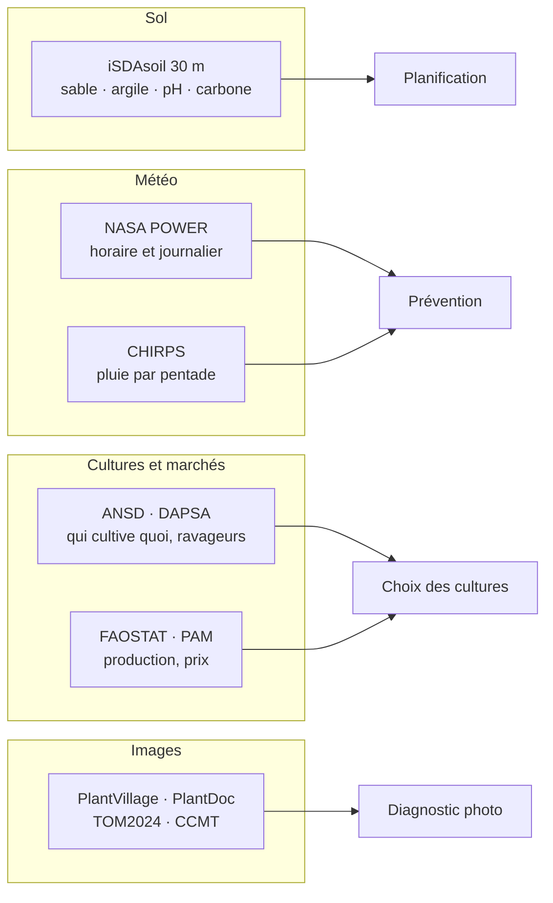

  
  
  

## En un coup d'œil

Chaque module de TerraMind repose sur des données publiques, téléchargées par script, avec leur source, leur licence et leur empreinte.

| Dossier | Contenu | Dans Git ? |
|---|---|---|
| [`raw/`](raw/) | Fichiers bruts tels que téléchargés, et [`MANIFESTE.csv`](raw/MANIFESTE.csv) (URL, date, SHA-256 de chaque fichier) | Les petits fichiers oui ; images, météo horaire, prix et documents non (retéléchargeables par script) |
| [`extraits/`](extraits/) | Tableaux tirés des rapports publics (RGPH-5, enquêtes agricoles), comparaison des zones, inventaire des images ; détail dans [`SOURCES.csv`](extraits/SOURCES.csv) | Oui |
| [`sample/`](sample/) | Petits échantillons publics pour les tests | Oui |
| [`CATALOGUE.md`](CATALOGUE.md) | Toutes les sources repérées : téléchargées, demandées, à obtenir | Oui |

**Ce que les données disent déjà** :
- Dans la région de Thiès, en contre-saison froide, l'oignon est cultivé par 56 % des ménages maraîchers, la tomate par 53 % et le chou par 47 % (RGPH-5).
- 21 % des ménages agricoles de Thiès et 44 % de ceux de Louga ont subi des ravageurs inhabituels (DAPSA, 2022-2023).

Pour tout retélécharger, voir [scripts/](../scripts/).

---

# Données : registre de provenance

Toute donnée utilisée par le projet (entraînement, évaluation, cartes, météo, échantillons) est inscrite ici **avant** d'être utilisée.

Règles :
- Aucune donnée inventée.
- Les photos et positions GPS de vrais agriculteurs ne sont jamais commitées.
- Les gros fichiers (images, rasters, archives, modèles) restent hors Git ; seul `data/sample/` contient de petits échantillons publics.

Comment les sources ont été trouvées et vérifiées : [docs/sources/journal-recherche-agronomique.md](../docs/sources/journal-recherche-agronomique.md).

| Nom | Source | URL | Licence | Date de téléchargement | Usage | Responsable |
|---|---|---|---|---|---|---|
| Guide pratique du maraîchage au Sénégal (Tableaux 1 et 3, fiches cultures) | J. Beniest et al., ISRA / FAO, CDH Cambérène, 1987 | https://open-library.cirad.fr/files/4/751__Guide_pratique_du_maraichage_au_Senegal.pdf | © ISRA-FAO 1987, diffusé en libre accès par la bibliothèque ouverte du CIRAD ; conditions de réutilisation à vérifier | 2026-10-30 | Brouillon de table sol → culture et fiches maladies (`research/`), non validé | Salam (collecte), Rama (contenu) |
| Superficie, rendement et production agricoles, 2010-2024 (`raw/dapsa_superficie_rendement_production_2010-2024_odp_2026-10-30.csv`) | Producteur : DAPSA (Enquête agricole annuelle) ; diffusé par l'ANSD sur le Senegal Data Portal | https://senegal.opendataforafrica.org/ekihmme/superficie-rendement-et-production-agricoles | Accord de licence de données ouvertes de l'ANSD (gratuite, non exclusive, usage commercial autorisé, attribution obligatoire, voir ci-dessous) | 2026-10-30 | Contexte statistique pour le choix des cultures et de la zone pilote (maïs surtout) ; aucune culture maraîchère dans ce fichier | Salam |
| FAOSTAT, production végétale et animale, extrait Sénégal 1961-2024 (`raw/faostat/`) | FAO | https://bulks-faostat.fao.org/production/Production_Crops_Livestock_E_Africa.zip | CC BY 4.0 | 2026-10-30 | Choix des cultures (production nationale de tomate, pomme de terre, oignon, maïs…) | Salam |
| NASA POWER, météo journalière 1991-2025 et horaire 2020-2025, 4 points pilotes (`raw/nasa_power/`) | NASA Langley Research Center, projet POWER (réanalyse MERRA-2) | https://power.larc.nasa.gov/ (URL exacte de chaque requête dans `raw/MANIFESTE.csv`) | Données publiques de la NASA, citation demandée | 2026-10-30 | Module Prévention (règles météo), calendrier cultural | Salam |
| Prix alimentaires du Sénégal 2000-2026 (`raw/wfp_prix/`) | PAM (WFP), source primaire ANSD et SIM via FAO GIEWS, diffusé sur HDX | https://data.humdata.org/dataset/wfp-food-prices-for-senegal | CC BY-IGO | 2026-10-30 | Choix des cultures (demande, valeur marchande), pitch | Salam |
| Limites administratives du Sénégal, régions et départements (`raw/geoboundaries/`) | geoBoundaries (William & Mary), source Gouvernement du Sénégal et OCHA, 2019 | https://www.geoboundaries.org/ | CC BY 3.0 IGO | 2026-10-30 | Cartes, tableau de bord, calcul des points pilotes | Salam |
| CHIRPS v3.0, pluie par pentade 1991-2025 aux 4 points pilotes (`raw/chirps/`) | Climate Hazards Center, UCSB (Funk et al., 2026, Scientific Data) | https://data.chc.ucsb.edu/products/CHIRPS/v3.0/ | Domaine public (renonciation CC0) | 2026-11-02 | Module Prévention et calendrier cultural (début et fin des pluies, cumuls) | Salam |
| iSDAsoil, propriétés des sols à 30 m aux 4 points pilotes (`raw/isdasoil/`) | iSDA (Hengl et al., 2021, PLOS Biology) | https://isdasoil.s3.amazonaws.com/ (registre AWS : https://registry.opendata.aws/isdasoil/) | CC BY 4.0 | 2026-11-02 | Module Planification (texture, pH, fertilité) | Salam |
| Photos de feuilles pour le diagnostic, tomate, pomme de terre, poivron (`raw/images/`, exclu de Git ; inventaire `extraits/images_diagnostic_inventaire.csv`) | PlantVillage (Mohanty, Hughes et Salathé 2016) ; PlantDoc (Singh et al. 2020) | https://huggingface.co/datasets/mohanty/PlantVillage ; https://github.com/pratikkayal/PlantDoc-Dataset | CC BY-SA 3.0 (PlantVillage : toute rediffusion des images, même modifiées, reste en CC BY-SA avec attribution ; statut des poids d'un modèle entraîné dessus à vérifier avant diffusion publique) ; CC BY 4.0 (PlantDoc) | 2026-11-02 | Module Diagnostic : entraînement (PlantVillage) et test sur photos de champ (PlantDoc) | Oscar |
| Rapports publics et tableaux extraits (`raw/documents/`, `extraits/`) | ANSD (RGPH-5 2023, SES 2019, bulletin oct. 2023), DAPSA (EAA 2020-2021 et 2022-2023, via les documents publics d'ANADS), ministère de l'Agriculture (forum horticulture 2025) | URL exactes dans `raw/MANIFESTE.csv` ; sources des extraits dans `extraits/SOURCES.csv` | Licence de données ouvertes de l'ANSD pour les publications ANSD ; DAPSA : citer « Enquête agricole annuelle, DAPSA » ; à vérifier pour le document du ministère | 2026-11-02 | Choix des cultures (part des ménages qui cultivent chaque légume par région, production nationale), pitch | Salam |

## Notes par jeu de données

Inventaire complet des sources (téléchargées, demandées, à obtenir) : [CATALOGUE.md](CATALOGUE.md). Empreintes et URL exactes des fichiers téléchargés par script : [raw/MANIFESTE.csv](raw/MANIFESTE.csv).

### Sources téléchargées par `scripts/donnees/telecharger_sources.py`

- FAOSTAT : `faostat_qcl_senegal_extrait.csv` est un **extrait** (lignes « Senegal » du fichier Afrique), valeurs non modifiées. Regarder les colonnes d'indicateurs (F, N) : une partie des valeurs sont des estimations de la FAO, pas des chiffres officiels.
- NASA POWER : les points sont les centroïdes des départements (voir CATALOGUE.md), pas des parcelles. Heures en UTC (= heure du Sénégal). Citation à reprendre : « These data were obtained from the NASA Langley Research Center (LaRC) POWER Project funded through the NASA Earth Science/Applied Science Program. »
- PAM (WFP) : la première ligne de données est une ligne d'étiquettes HXL (commence par `#`) à ignorer. Les prix de légumes ne couvrent que mai à août 2026.
- geoBoundaries : découpage 2019, sans le département de Keur Massar (créé en 2021).
- iSDAsoil : **extrait** (pixel de 30 m sous chaque centroïde), lu dans les COG publics d'AWS par requêtes partielles, sans compte. Moyennes retransformées selon la règle de chaque fichier de métadonnées ; écarts types laissés bruts. **Azote total** : les métadonnées d'AWS indiquent « expm1(x/10) », ce qui donne des valeurs impossibles (445 g/kg) ; le catalogue Google Earth Engine d'iSDA (`ISDASOIL/Africa/v1/nitrogen_total`) indique `exp(x/100)-1`, retenu : 0,25 à 0,84 g/kg, plausible pour des sables. Les règles des autres propriétés concordent entre les deux sources (vérifié le 2 nov 2026 pour carbone, P, K, Ca, CEC, cailloux). Texture : classe USDA d'après la table de légende publiée avec la carte (`metadonnees/texture_class_attribute_table.csv`). Valeurs plausibles pour les Niayes : 59 à 83 % de sable, pH 6,3 à 6,9.
- Rapports : les tableaux de `extraits/` sont recopiés des documents sans modification des valeurs, avec contrôles automatiques sur des chiffres cités dans le texte. Les productions moyennes par ménage de l'EAA 2020-2021 reposent sur de petits échantillons par région : ne les présenter que comme des ordres de grandeur.
- CHIRPS v3 : **extrait** (valeur du pixel de 0,05°, environ 5,5 km, sous chaque centroïde), lu directement dans les fichiers COG mondiaux par requêtes HTTP partielles. Pentades 1 à 5 = jours 1-5 à 21-25, pentade 6 = du 26 à la fin du mois. Totaux sur 5 jours (le produit journalier v3 n'est qu'une redistribution des pentades). Cumul annuel moyen 1991-2025 : environ 470 mm (Rufisque), 550 mm (Thiès), 475 mm (Tivaouane), 465 mm (Kébémer). Citer : Funk, C. et al. (2026). The Climate Hazards Center Infrared Precipitation with Stations, Version 3. Scientific Data, 13, 718.

### Superficie, rendement et production agricoles (DAPSA / ANSD)

- Fichier brut conservé tel quel, sans modification. SHA-256 : `12b3cea1358bdcd0c6aff1db5be1fc21230804ab55de9ea36bab11d9c6081645` (9 955 lignes).
- Contenu : 8 cultures pluviales (arachide, fonio, maïs, manioc, mil, niébé, riz, sorgho) ; superficie (ha), production (t), rendement (kg/ha) ; national et régional de 2010 à 2022, départemental de 2017 à 2022, puis 2024 (pas de 2023).
- Mention de source obligatoire (licence ANSD) : « Source : Agence Nationale de la Statistique et de la Démographie. Contient des informations sous licence conformément à l'Accord de licence de données ouvertes de l'ANSD. » Pour un produit dérivé (graphique, table, slide) : « Ce produit a été adapté à partir des informations de l'Agence Nationale de la Statistique et de la Démographie, qui sont sous licence conformément à l'Accord de licence de données ouvertes de l'ANSD. »
- Point à vérifier : la licence ANSD exclut les données de tiers. Le producteur étant la DAPSA, citer aussi « Enquête agricole annuelle, DAPSA, www.dapsa.gouv.sn » et confirmer auprès de l'ANSD ou de la DAPSA que cette licence couvre bien ce jeu.
- La licence interdit de suggérer une approbation officielle : ne pas présenter TerraMind comme validé par l'ANSD ou la DAPSA.
- Anomalies à exclure de toute analyse : rendement arachide Région de Dakar 2013-2016 égal à l'année (erreur de saisie) ; Bignona 2010-2015, série identique copiée sur toutes les cultures ; Birkilane 2010-2012 et maïs Région de Kolda 2010-2012, valeurs recopiées d'autres lignes ; plusieurs lignes 2024 à zéro ou sans unité (zéro possiblement = non enquêté) ; Région de Dakar = Rufisque à partir de 2017 (ne pas additionner).
