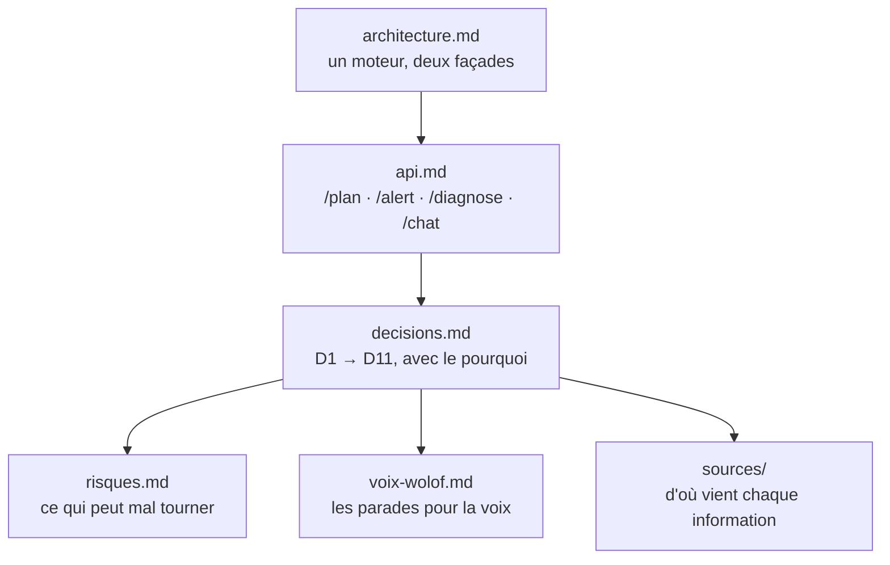

  
  

## En une phrase

Tout ce qui explique **pourquoi** le projet est fait ainsi : l'architecture, le contrat entre les briques, les décisions datées, les risques, et le journal des recherches qui prouve d'où vient chaque information.

## Par où commencer (lecture en 10 minutes)

## Ce qu'il contient

| Fichier | Contenu |
|---|---|
| [`architecture.md`](architecture.md) | Les briques du système et comment elles se parlent |
| [`api.md`](api.md) | Le contrat des points d'entrée du moteur |
| [`decisions.md`](decisions.md) | Chaque choix important, daté, avec sa raison (RAG obligatoire, wolof à l'oral, aucune donnée inventée, Prévention élargie aux ravageurs…) |
| [`risques.md`](risques.md) | Risques identifiés et parades |
| [`voix-wolof.md`](voix-wolof.md) | Chaîne de secours pour la voix wolof, contrôles automatiques, accès aux modèles |
| [`TACHES.md`](TACHES.md) | Le plan de tâches de l'équipe, jalon par jalon |
| [`strategie-donnees-manquantes.md`](strategie-donnees-manquantes.md) | Pour chaque donnée qui manque : comment la combler, comment s'en passer, comment le bot la produira avec les agriculteurs |
| [`sources/journal-recherche-agronomique.md`](sources/journal-recherche-agronomique.md) | Le journal daté de toutes les recherches : requêtes, sources lues, ce qui n'a pas été trouvé |
| [`sources/seuils-meteo-maladies-ravageurs.md`](sources/seuils-meteo-maladies-ravageurs.md) | Règles météo du module Prévention (mildiou, alternariose, mineuse, teigne du chou) et premier test |
| [`sources/demandes-acces.md`](sources/demandes-acces.md) | Demandes de données envoyées aux institutions et leur suivi |
| [`rapports-hebdo/`](rapports-hebdo/) | Rapports hebdomadaires du concours |
| `assets/readme/` | Illustrations des README (générées par `scripts/outils/generer_bannieres.py`) |

## Un exemple de traçabilité

> Le module Prévention prévient de la teigne du chou en février.
> **Pourquoi ?** Décision [D11](decisions.md). **Sur quelle base ?** Rapport STDF/AUMN sur le chou des Niayes, p. 5, et Enquête agricole annuelle 2022-2023 (insecticides sur 99 % des parcelles de chou). **Où est la recherche ?** Session 3 du [journal](sources/journal-recherche-agronomique.md).

## Responsable

**Salam** (suivi, décisions, rapports), avec toute l'équipe.
