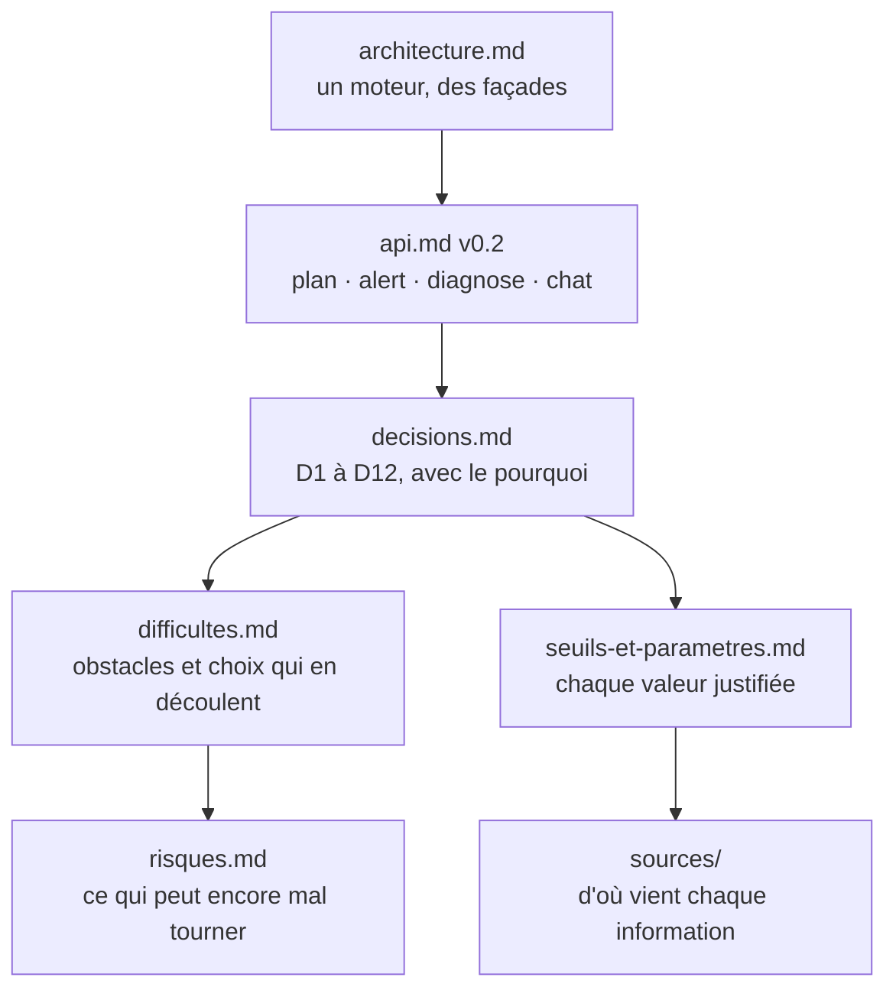

  
  
  

## En une phrase

Tout ce qui explique **pourquoi** le projet est fait ainsi : l'architecture, le contrat entre les briques, les décisions datées, les difficultés rencontrées, la justification de chaque seuil, et le journal des recherches qui prouve d'où vient chaque information.

## Par où commencer (lecture en 15 minutes)

## Ce qu'il contient

| Fichier | Contenu |
|---|---|
| [`architecture.md`](architecture.md) | Les briques du système et comment elles se parlent |
| [`api.md`](api.md) | Le contrat des points d'entrée du moteur (v0.2), avec l'état réel de chacun |
| [`decisions.md`](decisions.md) | Chaque choix important, daté, avec sa raison : aucune donnée inventée (D6), RAG obligatoire (D8), wolof à l'oral (D10), Prévention élargie aux ravageurs (D11), Telegram et application mobile pour la démonstration (D12)… |
| [`difficultes.md`](difficultes.md) | Les obstacles réels : expertise, données, wolof, hébergement, blocage de WhatsApp par Meta, et la décision prise à chaque fois. **À lire pour comprendre nos choix de méthode.** |
| [`seuils-et-parametres.md`](seuils-et-parametres.md) | Chaque valeur numérique (seuils d'alerte, seuil du diagnostic, score du RAG…) avec sa justification : source publiée, mesure ou raisonnement |
| [`risques.md`](risques.md) | Risques identifiés et parades |
| [`voix-wolof.md`](voix-wolof.md) | Chaîne de secours pour la voix wolof, contrôles automatiques, accès aux modèles |
| [`strategie-donnees-manquantes.md`](strategie-donnees-manquantes.md) | Pour chaque donnée qui manque : la combler, s'en passer, ou l'apprendre avec les agriculteurs |
| [`maquettes/references-ecrans.md`](maquettes/references-ecrans.md) | Écrans d'applications de référence et comment nous les avons adaptés |
| [`TACHES.md`](TACHES.md) | Le plan de tâches de l'équipe, jalon par jalon |
| [`sources/journal-recherche-agronomique.md`](sources/journal-recherche-agronomique.md) | Le journal daté de toutes les recherches |
| [`sources/seuils-meteo-maladies-ravageurs.md`](sources/seuils-meteo-maladies-ravageurs.md) | Règles météo du module Prévention et leur test sur 2020-2025 |
| [`sources/demandes-acces.md`](sources/demandes-acces.md) | Demandes de données envoyées aux institutions |
| [`rapports-hebdo/`](rapports-hebdo/) | Rapports hebdomadaires du concours |
| `assets/readme/` | Bannières des README (`scripts/outils/generer_bannieres.py`) |

## Un exemple de traçabilité

> Le diagnostic dit « je ne suis pas sûr » sous une confiance de 0,6.
> - **Pourquoi 0,6 ?** [seuils-et-parametres.md](seuils-et-parametres.md) § 3 : sur la validation de terrain, 90 % des photos dépassent 0,6, avec 90 % de réponses justes. 0,4 ne donnait que 62 % de réponses justes sur les photos de type PlantDoc.
> - **Où sont les chiffres ?** [ml/eval/diagnostic_v1.md](../ml/eval/diagnostic_v1.md).
> - **Pourquoi ne pas nommer quand même une maladie ?** Décisions D6 et D8 : rien d'inventé ; mieux vaut orienter vers un agent agricole.

## Responsable

**Salam** (suivi, décisions, rapports), avec toute l'équipe.
