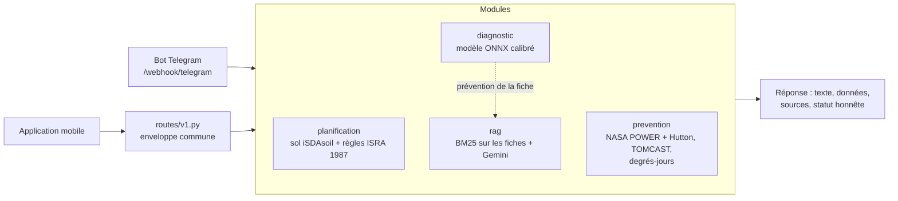

<p align="center"></p>

<p align="center">
  
  
  
  
</p>

## En une phrase

Le moteur reçoit la demande de l'agriculteur (position, photo, culture, question), fait tout le travail agronomique, puis renvoie une réponse **sourcée**. L'application mobile et le bot Telegram ne font qu'afficher ce qu'il produit.

## Le trajet d'une demande



Chaque réponse suit la même **enveloppe** ([docs/api.md](../docs/api.md)) : un `statut` (`ok`, `incertain`, `je_ne_sais_pas`, `culture_requise`, `erreur`), un texte, les données, et la liste des **sources**.

## Les points d'entrée

| Point d'entrée | Ce qu'il fait | Code |
|---|---|---|
| `POST /v1/plan` | Lit le sol au point du champ (sable, argile, pH), croise avec le mois, le sel et l'acidité, et classe 6 cultures : conseillée, possible, pas maintenant | [`modules/planification/`](app/modules/planification/) |
| `POST /v1/alert` | Analyse la météo des 7 derniers jours disponibles : mildiou (Hutton plafonné à 26,6 °C), alternariose (TOMCAST), mineuse et teigne (générations depuis le repiquage) | [`modules/prevention/`](app/modules/prevention/), [`modules/meteo.py`](app/modules/meteo.py) |
| `POST /v1/diagnose` | Photo d'une feuille → 3 maladies probables avec leur confiance ; sous le seuil de 0,6, « je ne suis pas sûr » ; sinon, la prévention tirée de la fiche | [`modules/diagnostic/modele.py`](app/modules/diagnostic/modele.py) |
| `POST /v1/chat` | Question libre → passages des fiches (BM25), reformulés par Gemini à partir de ces seuls passages ; hors sujet → « je ne sais pas » | [`modules/rag/`](app/modules/rag/) |
| `POST /v1/feedback` | Retour « j'ai vu / rien vu » après une alerte (journalisé, pas encore stocké) | [`routes/v1.py`](app/routes/v1.py) |
| `POST /webhook/telegram` | Bot Telegram : position → plan, photo → diagnostic, culture et date → alertes, texte → fiches | [`routes/telegram.py`](app/routes/telegram.py) |
| `GET /sante` | Le service répond | [`main.py`](app/main.py) |

Le bot WhatsApp est archivé dans [archives/whatsapp/](../archives/whatsapp/) ([D12](../docs/decisions.md)).

> **Analogie Kuroko no Basket** : sous le seuil de confiance, le moteur fait comme Kuroko. Plutôt que de forcer un tir raté, il fait la passe : « je ne suis pas sûr, montre ta plante à un agent agricole ». Concrètement, aucune maladie n'est nommée quand la probabilité calibrée est sous 0,6.

## Les règles que le moteur respecte

- **Rien d'inventé** : une réponse sans source n'est pas envoyée ([D6, D8](../docs/decisions.md)).
- **Jamais de produit chimique ni de dose** : pour un traitement, il renvoie vers un agent agricole.
- **Prudence** : on parle de « conditions favorables » et de « première indication », jamais de diagnostic sûr.
- **Vie privée** : position arrondie à 0,01° (environ 1 km), identifiant anonyme, aucun numéro.
- **Chaque seuil est justifié** : [docs/seuils-et-parametres.md](../docs/seuils-et-parametres.md).

## Lancer et tester

```bash
# depuis la racine du dépôt
python3 -m venv .venv && .venv/bin/pip install -r engine/requirements.txt
.venv/bin/uvicorn engine.app.main:app --reload --port 8000
.venv/bin/python -m unittest discover engine/tests

# essai rapide
curl -s -X POST localhost:8000/v1/chat -H 'Content-Type: application/json' \
  -d '{"utilisateur":"essai","canal":"mobile","langue":"fr","texte":"Quand semer l oignon ?"}'
```

Variables (`.env`, modèle dans [.env.example](../.env.example)) : `GEMINI_API_KEY` (facultative : sans elle, le RAG renvoie le passage de fiche tel quel), `TELEGRAM_BOT_TOKEN` et `TELEGRAM_WEBHOOK_SECRET` (bot), `MODEL_PATH` (dossier du modèle, par défaut `modeles/diagnostic/`).

**Déploiement** : [deploy/Dockerfile](../deploy/Dockerfile) construit une image contenant uniquement `engine/`, les fiches et le modèle (aucun secret), hébergée sur Render.

## Limites connues

- La première lecture du sol prend 15 à 30 s (téléchargement d'une tuile iSDAsoil), puis le résultat est gardé en cache.
- Le bot Telegram garde l'état de la conversation en mémoire : il est perdu au redémarrage du service.
- Le wolof n'est pas encore branché. Le moteur répond en français et l'indique (`langue: "fr"`). La normalisation pour la voix est prête : [`responses/voix/normalisation.py`](app/responses/voix/normalisation.py), [docs/voix-wolof.md](../docs/voix-wolof.md).

## Responsables

**Salam** (moteur, façades), avec **Oscar** pour les modules (les modules Planification, Prévention et Diagnostic sont proposés à sa revue).
