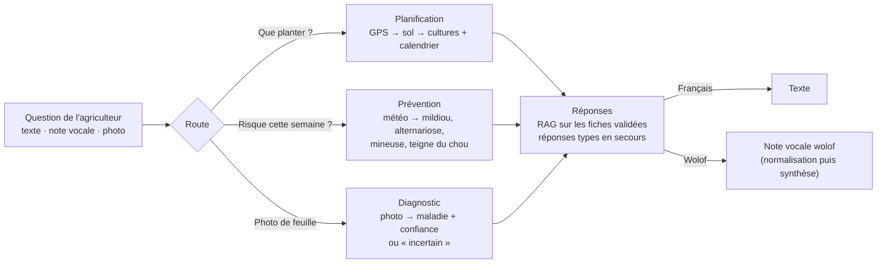

<p align="center"></p>

<p align="center">
  
  
  
</p>

## En une phrase

Le moteur reçoit la question d'un agriculteur (texte, note vocale ou photo), fait le travail agronomique, puis renvoie une réponse **sourcée** dans la langue de l'agriculteur. WhatsApp, l'appli web et le tableau de bord ne font qu'afficher ce qu'il produit.

> **Analogie** : le moteur est le meneur de jeu de l'équipe. Il reçoit tous les ballons (WhatsApp, appli web) et les distribue au bon module, sans que l'agriculteur le voie.

## Ce qu'il fait, concrètement



| Point d'entrée | Rôle | Module |
|---|---|---|
| `/plan` | Quelles cultures pour ce sol et cette saison | `app/modules/planification/` |
| `/alert` | Conditions météo favorables à une maladie ou à un ravageur | `app/modules/prevention/` |
| `/diagnose` | Maladie probable sur une photo, avec un niveau de confiance | `app/modules/diagnostic/` |
| `/chat` | Question libre, réponse tirée des fiches (RAG) | `app/responses/` |

Le contrat détaillé de chaque point d'entrée est dans [docs/api.md](../docs/api.md).

## Ce qui existe déjà

| Élément | État | Où |
|---|---|---|
| Normalisation du texte wolof avant la voix : nombres en toutes lettres, lexique, découpage, blocage si mot inconnu | ✅ Fait, testé (6 tests) | [`app/responses/voix/normalisation.py`](app/responses/voix/normalisation.py) |
| Squelette FastAPI, réponses de démonstration `mock: true`, journal en base | 🚧 Jalon J1 (3 nov) | `app/routes/` |
| Modules réels branchés (`mock: false`) | 📅 Jalon J2 (10 nov) | `app/modules/` |

Exemple réel de la normalisation (le nombre 25 est écrit en wolof pour que la voix le lise juste) :

```text
Entrée : « Dafa wara jëmbët soble bi ci Noovambar, 25 kilo. »
Sortie : « Dafa wara jëmbët soble bi ci Noovambar, ñaar fukk ak juróom kilo. »
```

## Les règles que le moteur respecte

- **Rien d'inventé** : chaque réponse vient d'une fiche validée ([D8](../docs/decisions.md)). Si rien ne correspond, le bot dit « je ne sais pas » et oriente vers un agent agricole.
- **Jamais de produit chimique ni de dose** dans une réponse.
- **Wolof à l'oral d'abord** : la plupart des agriculteurs qui parlent wolof ne le lisent pas ([D10](../docs/decisions.md)). Les parades contre les défauts de la voix de synthèse sont décrites dans [docs/voix-wolof.md](../docs/voix-wolof.md).
- **Diagnostic prudent** : sous un seuil de confiance, la réponse est « incertain ».

## Lancer les tests

```bash
python3 -m unittest discover engine/tests
```

## Responsable

**Salam** (moteur, canaux) · modules métier avec **Oscar**. Voir [docs/TACHES.md](../docs/TACHES.md).
