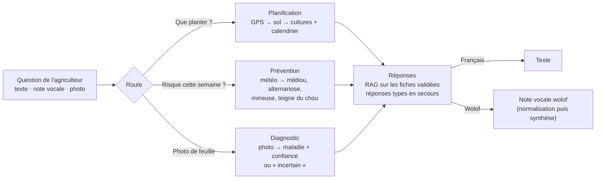

<p align="center"></p>

<p align="center">
  
  
  
</p>

## En une phrase

Le moteur reçoit la question d'un agriculteur (texte, note vocale ou photo), fait le travail agronomique, puis renvoie une réponse **sourcée** dans la langue de l'agriculteur. WhatsApp, l'appli web et le tableau de bord ne font qu'afficher ce qu'il produit.

> **Analogie** : le moteur est le meneur de jeu de l'équipe. Il reçoit tous les ballons (WhatsApp, appli web) et les distribue au bon module, sans que l'agriculteur le voie.

## Ce qu'il fait, concrètement



| Point d'entrée | Rôle | Module |
|---|---|---|
| `/plan` | Quelles cultures pour ce sol et cette saison | `app/modules/planification/` |
| `/alert` | Conditions météo favorables à une maladie ou à un ravageur | `app/modules/prevention/` |
| `/diagnose` | Maladie probable sur une photo, avec un niveau de confiance | `app/modules/diagnostic/` |
| `/chat` | Question libre, réponse tirée des fiches (RAG) | `app/responses/` |

Le contrat détaillé de chaque point d'entrée est dans [docs/api.md](../docs/api.md).

## Ce qui existe déjà

| Élément | État | Où |
|---|---|---|
| Normalisation du texte wolof avant la voix : nombres en toutes lettres, lexique, découpage, blocage si mot inconnu | ✅ Fait, testé (8 tests) | [`app/responses/voix/normalisation.py`](app/responses/voix/normalisation.py) |
| Module **Planification** (`sol(lat, lon)` + recommandation triée sur 8 cultures maraîchères) | ✅ Fait, branché (`mock: false`) | [`app/modules/planification/planificateur.py`](app/modules/planification/planificateur.py) |
| Module **Prévention** (NASA POWER + Hutton plafonné, TOMCAST, degrés-jours mineuse/teigne) | ✅ Fait, branché (`mock: false`) | [`app/modules/prevention/preventeur.py`](app/modules/prevention/preventeur.py) |
| Module **Diagnostic** (`predict(image_bytes)` entraîné sur 27 853 feuilles `terramind_v1`, 80,3 % test acc, tête embarquée dans `tete_terramind_v1.json`) | ✅ Fait, branché (`mock: false`) | [`app/modules/diagnostic/diagnostiqueur.py`](app/modules/diagnostic/diagnostiqueur.py) |
| Routes HTTP `/v1/plan`, `/v1/alert`, `/v1/diagnose` (JSON et `multipart/form-data`) | ✅ Fait, testé (27 tests) | [`app/routes/agronomie.py`](app/routes/agronomie.py) |

### Comment appeler les 3 modules d'Oscar depuis l'appli web (PWA) ou le bot WhatsApp

1. **Par HTTP (`POST /v1/diagnose`, `/v1/plan`, `/v1/alert`)** :
   - **Envoi de fichier (`multipart/form-data` depuis la PWA)** : champ fichier `photo` + champs `culture_declaree` (ex. `tomato`), `langue` (`fr` ou `wo`), `utilisateur`, `canal`.
   - **Envoi JSON (depuis le bot ou les tests)** : `{"image_base64": "...", "culture_declaree": "tomato", "langue": "wo"}`.
2. **Directement en Python dans le moteur (`engine/app/routes/whatsapp.py`)** :
   ```python
   from engine.app.modules.diagnostic import predict
   from engine.app.modules.planification import planifier
   from engine.app.modules.prevention import calculer_alertes

   # 1. Diagnostic d'une photo reçue sur WhatsApp (octets JPEG/PNG)
   res_diag = predict(image_bytes, culture_declaree="tomato")

   # 2. Planification à partir du GPS partagé
   res_plan = planifier(lat=14.76, lon=-17.21, date="2026-11-17", eau_puits_salee="non", champ_en_bas_fond="oui")

   # 3. Alertes météo de la semaine
   res_alert = calculer_alertes(lat=15.09, lon=-16.65, culture="tomato", date_repiquage="2026-10-01")
   ```
   > **Note pour le déploiement (Salam / Render)** : Les poids de la tête de classification entraînée sur les 27 853 images (`tete_terramind_v1.json`, 127 Ko) sont versionnés directement dans `engine/app/modules/diagnostic/tete_terramind_v1.json`. Le module reconstruit automatiquement le modèle PyTorch complet au démarrage sans nécessiter de gros fichier `.pt` dans Git.

Exemple réel de la normalisation (le nombre 25 est écrit en wolof pour que la voix le lise juste) :

```text
Entrée : « Dafa wara jëmbët soble bi ci Noovambar, 25 kilo. »
Sortie : « Dafa wara jëmbët soble bi ci Noovambar, ñaar fukk ak juróom kilo. »
```

## Les règles que le moteur respecte

- **Rien d'inventé** : chaque réponse vient d'une fiche validée ([D8](../docs/decisions.md)). Si rien ne correspond, le bot dit « je ne sais pas » et oriente vers un agent agricole.
- **Jamais de produit chimique ni de dose** dans une réponse.
- **Wolof à l'oral d'abord** : la plupart des agriculteurs qui parlent wolof ne le lisent pas ([D10](../docs/decisions.md)). Les parades contre les défauts de la voix de synthèse sont décrites dans [docs/voix-wolof.md](../docs/voix-wolof.md).
- **Diagnostic prudent** : sous un seuil de confiance, la réponse est « incertain ».

## Lancer les tests

```bash
python3 -m unittest discover engine/tests
```

## Responsable

**Salam** (moteur, canaux) · modules métier avec **Oscar**. Voir [docs/TACHES.md](../docs/TACHES.md).
