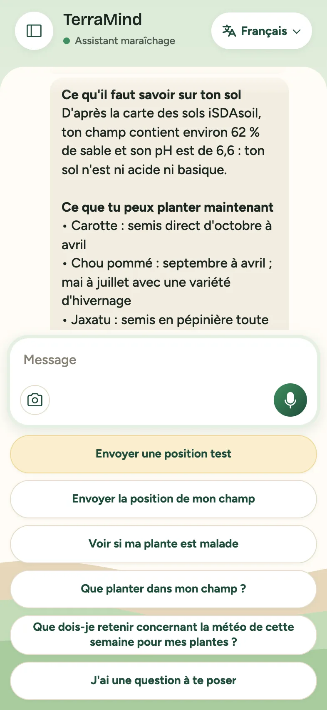

<p align="center"></p>

<p align="center">
  
  
</p>

Vue d'ensemble, lancement et tests : [`engine/README.md`](../README.md). Ici, où se trouve quoi.

```
app/
├── main.py              création de l'application FastAPI, /sante, journalisation
├── config.py            lecture de .env (aucun secret dans le code)
├── routes/
│   ├── v1.py            /v1/plan, /v1/alert, /v1/diagnose, /v1/chat (contrat : docs/api.md)
│   └── telegram.py      le bot @TerraMindAfriqueBot (boutons, notes vocales, français et wolof)
├── modules/
│   ├── planification/   que planter : cultures.py (règles du guide ISRA), sol.py (iSDAsoil), plan.py
│   ├── prevention/      alertes météo : regles.py (mildiou, alternariose, degrés-jours), alerte.py
│   ├── diagnostic/      modele.py : le modèle photo ONNX et son seuil d'incertitude (0,6)
│   ├── rag/             fiches.py (recherche BM25 dans content/fiches/), reponse.py (rédaction par Gemini)
│   ├── meteo.py         météo NASA POWER au point du champ
│   ├── ecoute.py        notes vocales wolof → texte (Octopus)
│   └── parole.py        texte → voix wolof, glossaire imposé
└── responses/voix/      normalisation du wolof avant la synthèse vocale
```

## Ce qu'une demande traverse

<p align="center">
  
  
  
</p>
<p align="center"><sub>Les trois écrans de l'application servis par <code>planification/</code>, <code>prevention/</code> et <code>diagnostic/</code> + <code>rag/</code>.</sub></p>

## Règles du code

- La position du champ est arrondie à 0,01° (environ 1 km) avant tout calcul.
- Les journaux ne contiennent jamais le contenu des messages ni de données personnelles.
- Aucune réponse ne propose de produit ou de dose (voir [`content/fiches/`](../../content/fiches/)).
