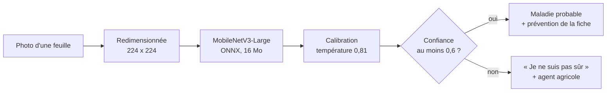
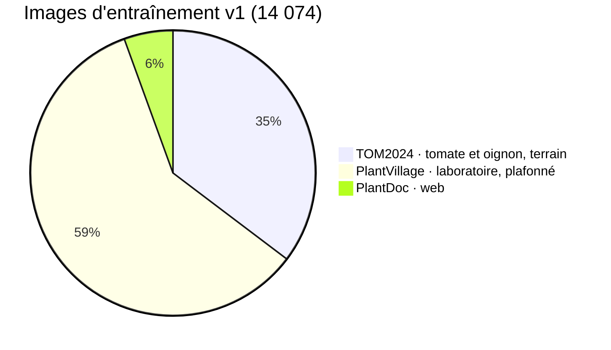

<p align="center"></p>

<p align="center">
  
  
  
</p>

## En une phrase

Le modèle regarde **la photo d'une feuille** et donne les maladies ou ravageurs les plus probables, avec une confiance **calibrée**. Sous le seuil, il répond honnêtement « je ne suis pas sûr ».

## De la photo à la réponse



## Les résultats, honnêtement

Chaque test porte sur des photos **jamais vues** à l'entraînement :

| Jeu de test | Images | v0 | **v1 (déployée)** |
|---|---|---|---|
| **TOM2024** : photos de terrain, Burkina Faso | 1 058 | — | **91,7 %** |
| **PlantDoc** : photos du web, très variées | 102 | 54,9 % | 56,9 % |
| Validation de terrain (sert à choisir le modèle) | 1 291 | — | 84,2 % |

Au **seuil de 0,6** : sur TOM2024, 93 % des photos sont jugées « sûres », dont 94 % de réponses justes. Sur PlantDoc, 60 % sont jugées sûres, dont 72 % justes.

- **Ce qui marche bien** : l'oignon (sain 99 %, chenilles 100 %, fusariose 95 %) et la virose de la tomate (90 %).
- **Ce qui marche mal** : le mildiou de la tomate (50 %, seulement 74 images d'entraînement), les acariens (71 %), et les photos de type PlantDoc.

Le seuil a été choisi après avoir vu les tests, ce qui rend ces derniers chiffres un peu optimistes ([diagnostic_v1.md](eval/diagnostic_v1.md)).

> **Analogie Kuroko no Basket** : un joueur qui ne s'entraîne qu'en salle vide brille à l'entraînement et se perd en match. C'est PlantVillage : 99,8 % sur ses photos de laboratoire en v0, mais 54,9 % au champ. La v1 s'est donc entraînée « en match », avec les photos de terrain de TOM2024, et elle est évaluée sur des photos de terrain.

## Les images d'entraînement (v1)



| Source | Contenu | Licence |
|---|---|---|
| **TOM2024** (Burkina Faso, Hugging Face `Project-AgML/TOM2024_disease_classification`) | Tomate et oignon, photos de terrain ; classes d'au moins 50 images | CC BY 4.0 |
| **PlantVillage** | Tomate, pomme de terre, poivron ; laboratoire, 600 images par classe au plus | CC BY-SA 3.0 |
| **PlantDoc** | Tomate, pomme de terre, poivron ; photos du web | CC BY 4.0 |

Étiquettes : vocabulaire commun de `data/label_mapping.csv`, défini par Oscar sur la branche `ml/dataset-merge` (base terramind_v1 : TOM2024 + CCMT, 35 448 images). Le modèle compte 26 classes, dont 5 pour l'oignon.

## Ce qu'il contient

| Fichier | Rôle |
|---|---|
| [`training/entrainer_diagnostic_v1.py`](training/entrainer_diagnostic_v1.py) | Entraînement v1 : données, découpage reproductible, calibration, export ONNX, métriques |
| [`training/entrainer_diagnostic.py`](training/entrainer_diagnostic.py) | Entraînement v0 (référence) |
| [`training/exporter_onnx.py`](training/exporter_onnx.py) | Export ONNX de la v0, avec contrôle de l'écart avec PyTorch |
| [`eval/diagnostic_v1.md`](eval/diagnostic_v1.md) | Résultats v1 commentés, choix du seuil et limites |
| [`eval/diagnostic_v1_mobilenet_v3_large.json`](eval/diagnostic_v1_mobilenet_v3_large.json) | Toutes les métriques : par classe, par seuil |
| [`eval/diagnostic_v0.md`](eval/diagnostic_v0.md) | Résultats de la v0 |
| [`MODEL_CARD.md`](MODEL_CARD.md) | Fiche du modèle (en cours) |

## Reproduire

```bash
# images : scripts/donnees/telecharger_images.py (PlantVillage, PlantDoc) ;
# TOM2024 : raw/train-00000-of-00001.parquet du jeu Hugging Face, dans data/raw/images/tom2024/
.venv/bin/python ml/training/entrainer_diagnostic_v1.py --arch mobilenet_v3_large --epoques 10
```

Environ 30 minutes sur un Mac M (accélération MPS). Le modèle est écrit dans `modeles/diagnostic_v1_mobilenet_v3_large/`, hors Git, puis copié dans `modeles/diagnostic/` pour le moteur. Le script lit les étiquettes depuis la branche `origin/ml/dataset-merge`.

## Limites et suite

- Pas de photos des Niayes : aucun test local pour l'instant (photos consenties à collecter).
- Chou absent du modèle ; mineuse de la tomate trop rare dans TOM2024 (19 images), donc couverte par les **alertes météo** et par une question de suivi après chaque photo de tomate.
- Déjà essayés et écartés : CCMT (Ghana) en v2 (moins bonne, biais de source) et ConvNeXt-Tiny (6,6 fois plus lourd pour environ 2 points) : voir [eval/](eval/).

## Responsable

**Oscar**. Le modèle v1 est proposé à sa revue.
