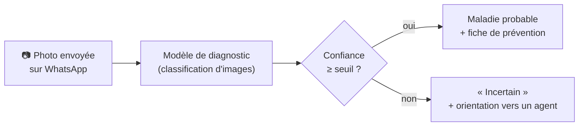
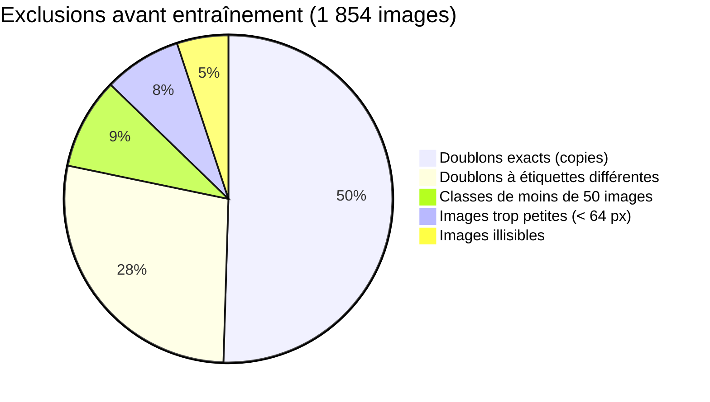

  
  
  

## En une phrase

Ce dossier contient le modèle qui regarde **la photo d'une feuille** et dit quelle maladie ou quel ravageur est probable, avec un niveau de confiance. Sous un seuil, il répond honnêtement « incertain » et le bot oriente vers un agent agricole.

## Du champ à la réponse

## Les images d'entraînement

| Source | Contenu | Licence | Rôle |
|---|---|---|---|
| **TOM2024** (Burkina Faso) | Photos de terrain : tomate, oignon, maïs | CC BY 4.0 | Base principale (conditions réelles) |
| **CCMT** (Ghana) | Cajou, manioc, maïs, tomate ; 24 071 images après nettoyage | CC BY 4.0 | Base principale |
| **PlantVillage** | 22 787 photos de laboratoire : tomate, pomme de terre, poivron | CC BY-SA 3.0 | Complément (fond uni) |
| **PlantDoc** | 1 100 photos de terrain : tomate, pomme de terre, poivron | CC BY 4.0 | Test en conditions réelles |
| **Chou** (Ghana, Mendeley Data 2025) | 203 images d'origine : alternariose, pourriture noire, mildiou, sain (versions augmentées écartées) | CC BY 4.0 | Première base pour le chou |

La base fusionnée **terramind_v1** (TOM2024 + CCMT) fait **35 448 images, 5 cultures, 40 classes**, après retrait des images illisibles, des doublons et des images à étiquettes contradictoires. Elle est construite par `ml/training/build_merged_dataset.py`, sur la branche `ml/dataset-merge` d'Oscar, pas encore fusionnée.

## Ce qui est connu comme limite

- **Chou : peu d'images** (203, dont 28 de mildiou et 37 de pourriture noire), **aucune de la teigne**. L'oignon n'est présent que dans TOM2024.
- **La mineuse de la tomate** (*Tuta absoluta*) a trop peu d'images (17) : le diagnostic ne la reconnaîtra pas encore. Elle est couverte par les **alertes météo** du module Prévention ([D11](../docs/decisions.md)).
- Les photos de laboratoire (PlantVillage) ont un fond uni : un modèle entraîné seulement dessus se trompe au champ. D'où le test sur PlantDoc et les photos de terrain.

## Structure

| Dossier | Contenu | État |
|---|---|---|
| [`notebooks/`](notebooks/) | Explorations | 📅 |
| [`training/`](training/) | Construction de la base, entraînement | 🚧 branche `ml/dataset-merge` |
| [`eval/`](eval/) | Évaluation par classe, seuil « incertain » | 📅 |
| [`MODEL_CARD.md`](MODEL_CARD.md) | Fiche du modèle : données, méthode, métriques, limites | 📅 version finale le 17 nov |

## Responsable

**Oscar**. Voir [docs/TACHES.md](../docs/TACHES.md).
