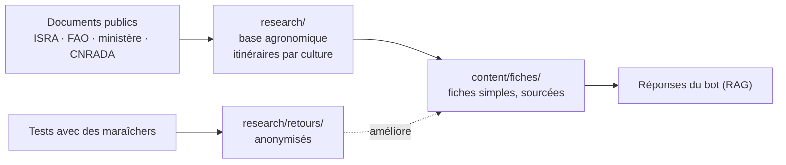

  
  

## En une phrase

Ce dossier rassemble **ce qu'on sait du terrain** : la base agronomique sourcée qui nourrit les fiches, les itinéraires techniques par culture, et tout ce qui encadre les tests avec de vrais maraîchers (protocole, consentement, retours anonymisés).

## Le chemin d'une information

## Ce qu'il contient

| Fichier | À quoi il sert | État |
|---|---|---|
| [`base-de-travail-agronomique.md`](base-de-travail-agronomique.md) | Tout ce que disent les sources sur les sols, la salinité, les saisons, les maladies ; ce qu'il reste à trouver ; questions pour un agronome | ✅ |
| [`itineraires-par-culture.md`](itineraires-par-culture.md) | Itinéraires techniques par culture (oignon, tomate, chou, pomme de terre, poivron, piment, jaxatu, carotte), avec la comparaison climat + sol des zones dont on emprunte les fiches | ✅ |
| [`brouillon_table_sol_culture.csv`](brouillon_table_sol_culture.csv) | Brouillon de la table « sol → cultures » du module Planification | 🚧 |
| [`protocole_test.md`](protocole_test.md) | Comment se dérouleront les tests avec les agriculteurs | 📅 10 nov |
| [`consentement.md`](consentement.md) | Formulaire de consentement (photos, voix, position) | 🚧 |
| [`retours/`](retours/) | Retours des tests, **anonymisés uniquement** | 📅 |

## Quand le Sénégal ne dit rien : comparer avant d'emprunter

Quand une information manque pour les Niayes, on peut la prendre dans une fiche d'une autre zone, à condition qu'elle ressemble aux Niayes **pour ce type d'information**. On compare le climat (température, humidité, pluie) et le sol (sable, argile, pH, carbone, capacité d'échange) :

| Zone | Écart climat | Écart sol | On peut lui emprunter |
|---|---|---|---|
| Niayes entre elles | 0,06 à 0,9 | 0,2 à 0,71 | (référence) |
| Dosso (Niger) | 1,63 | **0,38** | ce qui dépend du sol (fumure, arrosage) |
| Nouakchott (Mauritanie) | 1,42 | **0,47** | ce qui dépend du sol et de la température |
| Kaédi (Mauritanie, CNRADA) | 1,70 | 0,51 | gestes qui dépendent peu du climat |

0 = identique aux Niayes ; 1 = en moyenne un écart notable par critère. Les risques de maladies liées à l'humidité ne sont **jamais** empruntés à une zone sèche. Méthode et tableau complet : [itineraires-par-culture.md](itineraires-par-culture.md).

## Éthique

- Consentement écrit avant toute photo, voix ou position ([`consentement.md`](consentement.md)).
- Aucune donnée personnelle d'agriculteur dans Git : seuls les retours anonymisés sont commités.
- Aucune donnée inventée ([décision D6](../docs/decisions.md)) ; toute information a sa source.

## Responsables

**Rama** (tests, consentement, retours) · base agronomique préparée par l'équipe avec un assistant IA, sources vérifiées une à une. Voir [docs/TACHES.md](../docs/TACHES.md).
