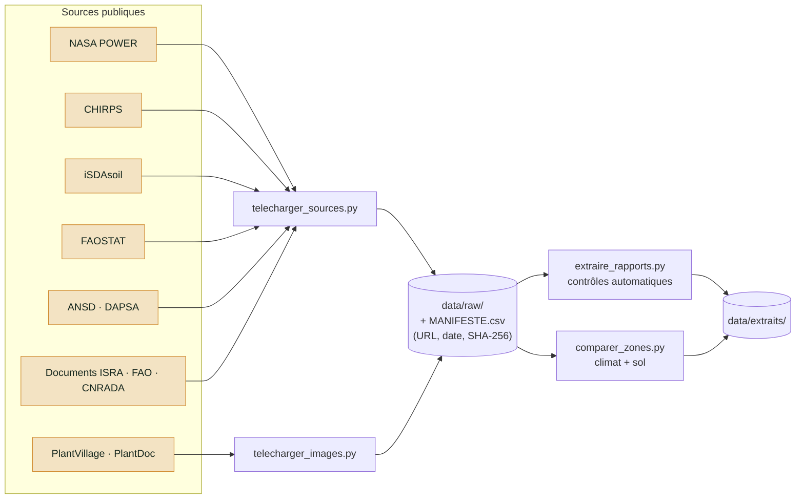

  
  

## En une phrase

Ces scripts **collectent et vérifient** les données du projet, de façon reproductible : n'importe qui peut les relancer et retrouver exactement les mêmes fichiers, avec leur empreinte et leur source.

## Comment les données arrivent dans le projet

## Les scripts

| Script | Ce qu'il fait | Exemple |
|---|---|---|
| [`donnees/telecharger_sources.py`](donnees/telecharger_sources.py) | Télécharge les sources ouvertes. Pour les grandes cartes (CHIRPS, iSDAsoil), il ne lit que les morceaux utiles par requêtes partielles, sans compte | `python3 -I scripts/donnees/telecharger_sources.py isdasoil` |
| [`donnees/telecharger_images.py`](donnees/telecharger_images.py) | Extrait seulement les classes utiles de PlantVillage (archive de 2,2 Go lue à distance) et de PlantDoc | `python3 scripts/donnees/telecharger_images.py` |
| [`donnees/extraire_rapports.py`](donnees/extraire_rapports.py) | Recopie des tableaux des rapports ANSD et DAPSA, et échoue si un chiffre de contrôle cité dans le rapport ne correspond pas | `python3 scripts/donnees/extraire_rapports.py` |
| [`donnees/comparer_zones.py`](donnees/comparer_zones.py) | Compare climat et sol des Niayes avec les zones dont on emprunte des fiches | `python3 -I scripts/donnees/comparer_zones.py` |
| [`outils/generer_bannieres.py`](outils/generer_bannieres.py) | Génère les illustrations des README | `python3 scripts/outils/generer_bannieres.py` |
| [`bootstrap_github.sh`](bootstrap_github.sh) | Crée les étiquettes et jalons GitHub du projet | `bash scripts/bootstrap_github.sh` |

## Principes

- **Traçabilité** : chaque fichier téléchargé est inscrit dans [`data/raw/MANIFESTE.csv`](../data/raw/MANIFESTE.csv) avec son URL, sa date et son empreinte SHA-256.
- **Contrôles qui échouent bruyamment** : un tableau mal lu arrête le script au lieu de produire de fausses valeurs.
- **Corrections documentées** : par exemple, la règle de l'azote d'iSDAsoil est corrigée d'après le catalogue officiel, avec la raison écrite dans le code.
- **Pas de contournement** : aucun script ne contourne une protection anti-robot ni ne se connecte avec un compte.

## Responsables

**Salam** et **Oscar**.
